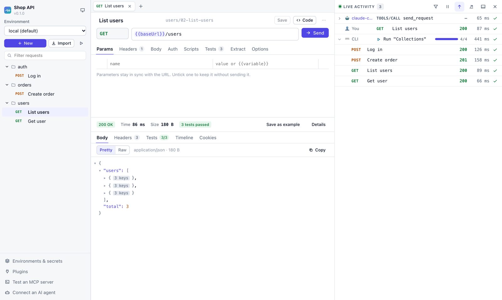

<div align="center">

<picture>
  <source media="(prefers-color-scheme: dark)" srcset="assets/logo-dark.svg">
  
</picture>

<p>
  <strong>An open, local-first API client for building, sending, testing and automating API requests, with everything visible live.</strong>
</p>

<p>
  
  
  
  
</p>

<p>
  <a href="#-features">Features</a> ·
  <a href="#-live-activity">Live Activity</a> ·
  <a href="#-plugins">Plugins</a> ·
  <a href="#-ai--mcp">AI &amp; MCP</a> ·
  <a href="guide/README.md">Guide</a>
</p>

</div>

<picture>
  <source media="(prefers-color-scheme: dark)" srcset="assets/screenshot-dark.png">
  
</picture>

---

> [!WARNING]
> **post-tester is in early development.** It works, but expect rough edges, and
> file formats and APIs may change before 1.0. Features marked *planned* are not built yet.

## 🚀 Quick start

```bash
# Build from source (Rust 1.97+, Node.js and pnpm)
pnpm install && pnpm --filter web build
cargo install --path crates/cli

pt init my-api && cd my-api     # create a workspace
pt send examples/get-ip         # send a request and watch it live
pt serve                        # open the app in your browser
```

```text
→ Get my IP
  GET https://httpbin.org/ip
  DNS 3 ms · Connect 152 ms · TLS 308 ms · Waiting 149 ms · Download 0 ms
← 200 OK  HTTP/2  31 B
  ✓ status == 200
  ✓ json($.origin) exists
```

## ✨ Features

<table>
  <tr>
    <td width="50%" valign="top">
      <h3>🏠 Local-first</h3>
      Your work lives in plain files on your machine. No account, no forced cloud.
    </td>
    <td width="50%" valign="top">
      <h3>🌿 Git-friendly</h3>
      One request per file, in readable YAML. Review changes in pull requests like code.
    </td>
  </tr>
  <tr>
    <td valign="top">
      <h3>📡 Live by default</h3>
      See everything as it happens, from a one-line summary down to the raw bytes.
    </td>
    <td valign="top">
      <h3>🔌 Plugins for everyone</h3>
      Add auth methods, importers, protocols and viewers in TypeScript, sandboxed and permission-based.
    </td>
  </tr>
  <tr>
    <td valign="top">
      <h3>🤖 AI-ready</h3>
      AI agents can use post-tester through MCP, and post-tester can test MCP servers.
    </td>
    <td valign="top">
      <h3>🖥️ Runs everywhere</h3>
      Browser, desktop app, terminal and CI, all powered by one engine. Mobile builds are prepared but not yet tested.
    </td>
  </tr>
</table>

### Protocols

| Protocol | Status | Protocol | Status |
|---|:-:|---|:-:|
| HTTP/1.1 and HTTP/2 | ✅ | MCP (server and client) | ✅ |
| GraphQL | ✅ | gRPC | planned |
| WebSocket | ✅ | MQTT | planned |
| Server-Sent Events | ✅ (streamed live) | | |

### Testing & automation

- **Tests** in one line each: `status == 200`, `json($.id) exists`, `time < 500`
- **Scripts** before requests and after responses, with Postman-compatible `pm.*`
- **Chaining**: extract values (`token: json($.token)`) and use them in the next request
- **Collection runner** for the app, the terminal and CI (JSON and JUnit reports)
- **Load testing** from any request, with p50/p90/p99 latency
- **Import** cURL, Postman collections and OpenAPI 3; **code generation** for cURL, JavaScript and Python
- **Mock API** from saved example responses (`pt mock`)
- *Planned:* response diff, visual flows

## 📡 Live Activity

Every action appears the moment it happens, whether you, an AI agent, the CLI, a plugin or a schedule started it.

```text
LIVE ACTIVITY                                       [⏸ Pause]  [Filter ▾]  [Follow ●]
──────────────────────────────────────────────────────────────────────────────────────
👤 You         POST /auth/login           200  ▓▓▓░░░░░  182 ms   1.2 KB        ▸
🤖 AI agent    GET  /users?page=2         200  ▓▓░░░░░░   96 ms   8.4 KB        ▸
▶  Run "Checkout flow"                    3/7  ●●●○○○○   running…               ▾
      ✓ Create cart            201    88 ms
      ✓ Add item               200    54 ms
      ⟳ Pay                    …      waiting for response (1.4 s)
🔌 my-plugin   created ticket #42                                                ▸
```

Click any row to see more, still updating live:

| Level | You see |
|---|---|
| **Summary** | Who started it, name, status, duration, size |
| **Details** | Timing breakdown (DNS · TCP · TLS · waiting · download), headers, body, logs, test results |
| **Raw** | The exact data sent and received |

## 🔌 Plugins

A plugin is a folder with a `plugin.json` and a TypeScript file:

```ts
import { definePlugin } from "@post-tester/plugin-sdk";

export default definePlugin({
  templateFunctions: {
    totp: {
      description: "Generate a 6-digit TOTP code from a base32 secret.",
      args: [{ name: "secret", type: "string" }],
      run: ({ secret }) => generateTotp(secret),
    },
  },
});
```

Then use it in any request: `{{totp(secret:"authenticator")}}`

- **Sandboxed.** Plugins can't touch your system unless you allow it.
- **Permission-based.** Plugins declare what they need, and you approve it on install.
- **AI-agent friendly.** The guide, typed SDK and validator are designed so an AI agent can write a working plugin on the first try.

👉 **[Read the plugin guide](guide/plugins/README.md)**

## 🤖 AI & MCP

post-tester supports the [Model Context Protocol](https://modelcontextprotocol.io) in **both directions**:

<table>
  <tr>
    <td width="50%" valign="top">
      <h4>As an MCP server</h4>
      AI agents can browse your collections, send requests and run tests, locally on your machine.
      <br><br>
      Every action an agent takes appears in <strong>Live Activity</strong>, and secrets are never shown to agents.
    </td>
    <td width="50%" valign="top">
      <h4>As an MCP client</h4>
      Connect to any MCP server, explore its tools, resources and prompts, call them, and write tests for them.
      <br><br>
      Every message is shown live.
    </td>
  </tr>
</table>

## 📚 Documentation

| Guide | Description |
|---|---|
| [Overview](guide/README.md) | Core ideas, concepts and workspace layout |
| [Command line](guide/cli.md) | Every `pt` command, request files, tests and CI |
| [AI agents and MCP](guide/mcp.md) | Connect an AI agent, and test MCP servers |
| [Building plugins](guide/plugins/README.md) | Everything needed to create a plugin, for people and AI agents |
| [Desktop and mobile app](apps/desktop/README.md) | Running and packaging the native app |
| [Local server API](crates/server/API.md) | The HTTP and WebSocket API behind the app |

## 🧱 Project layout

| Path | What it is |
|---|---|
| `crates/core` | The engine: requests, live events, tests, runner, import, codegen |
| `crates/plugin-host` | Sandboxed JavaScript runtime for plugins and scripts |
| `crates/mcp` | MCP server (for AI agents) and MCP client (for testing MCP servers) |
| `crates/server` | Local HTTP/WebSocket server that serves the app |
| `crates/cli` | The `pt` command |
| `apps/web` | The web UI |
| `apps/desktop` | The desktop/mobile app (Tauri) |
| `packages/plugin-sdk` | Types and helpers for plugin authors |
| `examples/plugins` | One working example plugin per type |

## 🤝 Contributing

post-tester is at an early stage. Ideas, feedback and issues are welcome.

```bash
cargo test --workspace --exclude post-tester-desktop   # Rust tests
pnpm --filter web test                                 # UI tests
pnpm --filter web dev                                  # UI with hot reload (run `pt serve` too)
```
