<a id="readme-top"></a>

<div align="center">

<picture>
  <source media="(prefers-color-scheme: dark)" srcset="assets/hero-dark.svg">
  
</picture>

<br>
<br>

&nbsp;
<a href="#-one-engine-everywhere"></a>&nbsp;
<a href="#-how-it-works"></a>&nbsp;
<a href="#-plugins"></a>&nbsp;
<a href="#-ai-agents-and-mcp"></a>

<p>A local-first API client for building, sending, testing and automating requests,<br>with everything visible live: for people, for the terminal and for AI agents.</p>

**[Quick start](#-quick-start)** &nbsp;·&nbsp;
**[Live Activity](#-live-activity)** &nbsp;·&nbsp;
**[Testing](#-test-chain-and-automate)** &nbsp;·&nbsp;
**[Plugins](#-plugins)** &nbsp;·&nbsp;
**[AI agents](#-ai-agents-and-mcp)** &nbsp;·&nbsp;
**[Platforms](#-one-engine-everywhere)** &nbsp;·&nbsp;
**[Guide](guide/README.md)**

</div>

<br>

<picture>
  <source media="(prefers-color-scheme: dark)" srcset="assets/demo-dark.gif">
  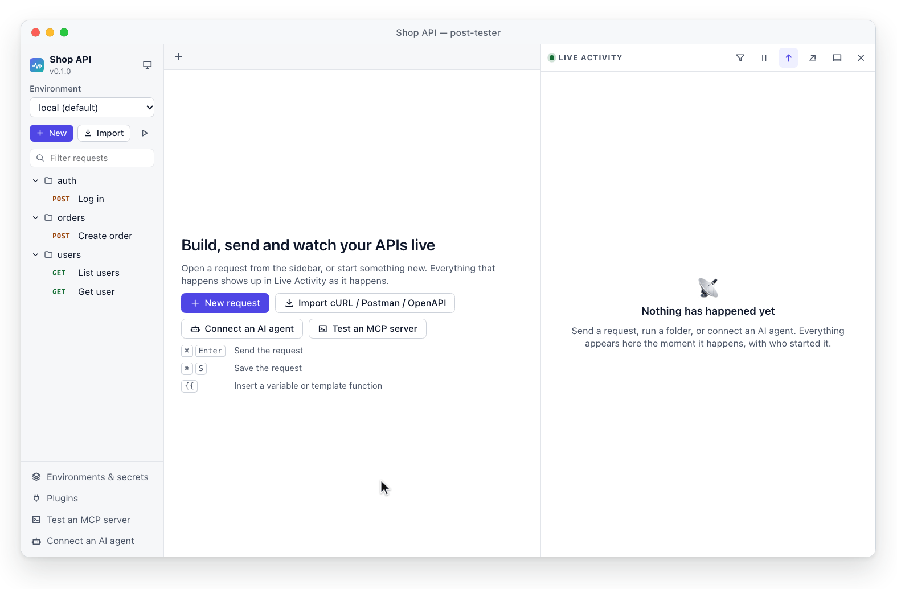
</picture>

<p align="center"><sub>A real recording. You send a request, a collection run starts in a terminal, an AI agent calls a tool over MCP,<br>and all of it shows up in <b>Live Activity</b> while it happens.</sub></p>

> [!WARNING]
> **post-tester is in early development.** It works, but expect rough edges, and
> file formats and APIs may change before 1.0. Features marked *planned* are not built yet.

## ✨ Highlights

<table>
  <tr>
    <td width="33%" valign="top">
      <a href="#-live-activity"></a>
      <h3>Live by default</h3>
      <p>Every request, test, run and agent action streams in as it happens. Click any row to go from a one-line summary down to the raw bytes.</p>
    </td>
    <td width="33%" valign="top">
      <a href="#-plugins"></a>
      <h3>Plugins for everyone</h3>
      <p>Auth methods, importers, viewers, agent tools and more, in TypeScript. Sandboxed, permission-based, and simple enough for an AI agent to write.</p>
    </td>
    <td width="33%" valign="top">
      <a href="#-ai-agents-and-mcp"></a>
      <h3>Agents welcome</h3>
      <p>AI agents use your workspace over MCP and refer to secrets only by name. And post-tester can test any MCP server.</p>
    </td>
  </tr>
</table>
<table>
  <tr>
    <td width="33%" valign="top">
      <a href="guide/README.md"></a>
      <h3>Local-first</h3>
      <p>Your work lives in plain files on your machine. No account, no forced cloud. Secrets are kept in your OS keychain, never in your request files.</p>
    </td>
    <td width="33%" valign="top">
      <a href="#-test-chain-and-automate"></a>
      <h3>Git-friendly</h3>
      <p>One request per file, in readable YAML. Review API changes in pull requests, like code.</p>
    </td>
    <td width="33%" valign="top">
      <a href="#-one-engine-everywhere"></a>
      <h3>Runs everywhere</h3>
      <p>The desktop app, your browser, the terminal and CI all run the same engine, on macOS, Windows and Linux.</p>
    </td>
  </tr>
</table>

## 🚀 Quick start

Build from source (Rust 1.97+, Node.js and pnpm):

```bash
pnpm install && pnpm --filter web build   # the web UI
cargo install --path crates/cli           # installs `pt`
```

Then create a workspace and send your first request:

```bash
pt init my-api && cd my-api   # create a workspace
pt send examples/get-ip       # send the sample request, live in the terminal
pt serve                      # open the app in your browser
```


<p align="center"><sub><code>pt send</code> shows each step as it happens: timing, status, tests, then the body.</sub></p>

<details>
<summary>Output as text</summary>

```text
$ pt send orders/create-order
→ Create order
  POST http://127.0.0.1:4010/orders
  DNS 0 ms · Connect 1 ms · Waiting 155 ms · Download 0 ms
← 201 Created  HTTP/1.1  53 B
  ✓ status == 201
  ✓ json($.status) == pending
  157 ms

{
  "id": "ord_123",
  "status": "pending",
  "total": 42.5
}
```

</details>

Prefer a native window? `cargo run -p post-tester-desktop` starts the [desktop app](apps/desktop/README.md).
In the app, <kbd>⌘</kbd>/<kbd>Ctrl</kbd> + <kbd>Enter</kbd> sends and <kbd>⌘</kbd>/<kbd>Ctrl</kbd> + <kbd>S</kbd> saves; in the desktop app, <kbd>⌘</kbd>/<kbd>Ctrl</kbd> + <kbd>O</kbd> opens another workspace.

## 📡 Live Activity

Every action appears the moment it happens, whoever started it: 👤 you, 🤖 an AI agent, ⌨️ a terminal, or 🔌 a plugin.
That includes work done in **other processes**: a `pt run` in your terminal or an agent using `pt mcp` shows up in the open app, live.

Click any row to see more, still updating live:

<p>
<picture>
  <source media="(prefers-color-scheme: dark)" srcset="assets/drilldown-dark.svg">
  
</picture>
</p>

| Level | You see |
|---|---|
| **Summary** | Who started it, name, status, duration, size |
| **Details** | Timing waterfall (DNS · TCP · TLS · waiting · download), headers, body, logs, test results |
| **Raw** | Every event recorded for it, including the exact data sent and received |

<details>
<summary><b>📸 Prefer still images?</b> Full-resolution screenshots, light and dark</summary>
<br>

<picture>
  <source media="(prefers-color-scheme: dark)" srcset="assets/screenshot-dark.png">
  
</picture>

</details>

## 🧪 Test, chain and automate

A request is a small YAML file. Tests and extracted values are one line each:

```yaml
# collections/auth/login.yaml
name: Log in
method: POST
url: "{{baseUrl}}/auth/login"
body: { type: json, content: '{"email": "ada@example.com", "password": "{{secret:password}}"}' }
tests: ["status == 200", "json($.token) exists"]
extract: { token: json($.token) }      # use {{token}} in the next request
```

Because every request is its own file, a change reviews like code:

```diff
 name: Create order
 method: POST
 url: "{{baseUrl}}/orders"
-tests: ["status == 201"]
+tests: ["status == 201", "json($.status) == pending"]
```

- **Tests** in one line each: `status == 200`, `json($.id) exists`, `time < 500`
- **Chaining**: values extracted by one request are available to the next
- **Scripts** before requests and after responses, with a Postman-compatible `pm.*` API
- **Collection runner** in the app, the terminal and CI; `pt run` writes JSON and JUnit reports
- **Load testing** from any request, with p50, p90 and p99 latency
- **Import** cURL, Postman collections and OpenAPI 3; **generate code** for cURL, JavaScript and Python
- **Mock API** from saved example responses (`pt mock`)
- *Planned:* response diff, visual flows


<p align="center"><sub><code>pt run</code> streams a whole collection, with test results and extracted variables, then a summary.</sub></p>

<details>
<summary>Output as text</summary>

```text
$ pt run
▶ Run "Shop API"
  → Log in
    POST http://127.0.0.1:4010/auth/login
    DNS 0 ms · Connect 1 ms · Waiting 124 ms · Download 0 ms
  ← 200 OK  HTTP/1.1  57 B
    ✓ status == 200
    ✓ json($.token) exists
    = token = eyJhbGciOiJIUzI1NiJ9.demo
    126 ms
  → Create order
    POST http://127.0.0.1:4010/orders
    DNS 0 ms · Connect 1 ms · Waiting 155 ms · Download 0 ms
  ← 201 Created  HTTP/1.1  53 B
    ✓ status == 201
    ✓ json($.status) == pending
    157 ms
  → Get user
    GET http://127.0.0.1:4010/users/1
    DNS 0 ms · Connect 1 ms · Waiting 65 ms · Download 0 ms
  ← 200 OK  HTTP/1.1  50 B
    ✓ status == 200
    ✓ json($.name) == Ada Lovelace
    68 ms
  → List users
    GET http://127.0.0.1:4010/users
    DNS 0 ms · Connect 1 ms · Waiting 84 ms · Download 0 ms
  ← 200 OK  HTTP/1.1  180 B
    ✓ status == 200
    ✓ json($.users) exists
    ✓ time < 1000
    86 ms

Shop API  4 requests · 4 passed · 0 failed · 0 errors · 439 ms
  tests: 9 total, 0 failed
```

</details>

In CI, `pt run` exits with `1` when a test fails:

```bash
pt run --reporter junit --output results.xml   # secrets come from PT_SECRET_* variables
```

### ⚡ Load testing


<p align="center"><sub><code>pt load</code> reports throughput and p50, p90 and p99 latency every second while it runs.</sub></p>

<details>
<summary>Output as text</summary>

```text
$ pt load users/list-users -n 2000 -c 50
→ Load test: GET List users
  i 2000 requests, 50 at a time, reusing connections
  i 550 req · 543.7 req/s · p50 86.4 ms · p90 91.2 ms · p99 94.1 ms · 0 failed
  i 1124 req · 558.1 req/s · p50 86.0 ms · p90 90.5 ms · p99 94.5 ms · 0 failed
  i 1700 req · 563.6 req/s · p50 85.7 ms · p90 89.8 ms · p99 94.2 ms · 0 failed
  i Finished: 2000 req · 574.8 req/s · p50 85.5 ms · p90 89.5 ms · p99 94.1 ms · 0 failed
  3.48 s

  requests     2000 (0 failed)
  throughput   574.8 req/s
  latency      min 81 ms · p50 86 ms · p90 90 ms · p99 94 ms · max 100 ms
  status       200×2000
```

</details>

## 🌊 Streams, live

WebSocket messages and Server-Sent Events appear one by one as they arrive, and you can send messages back from the same tab.

<p>
<picture>
  <source media="(prefers-color-scheme: dark)" srcset="assets/stream-dark.gif">
  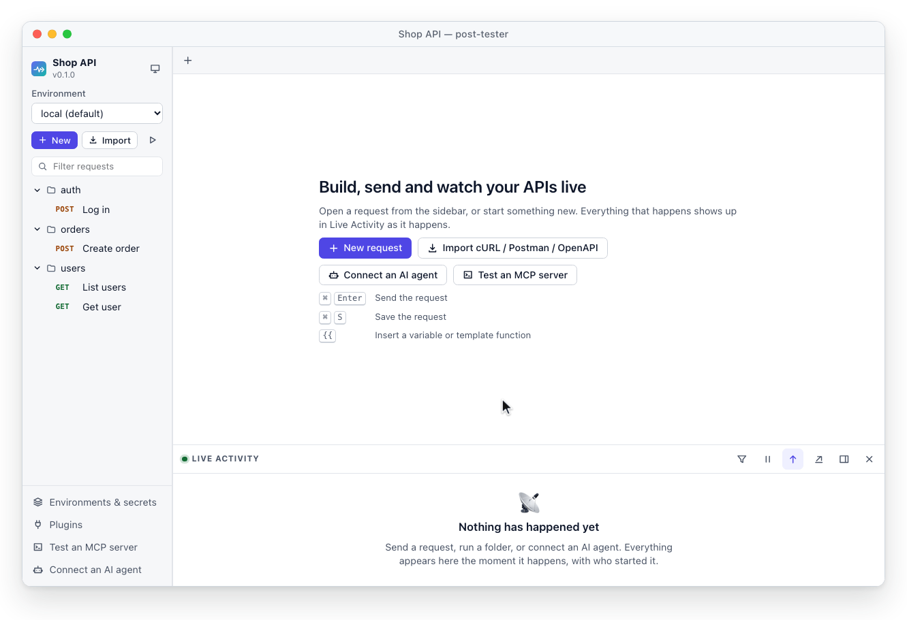
</picture>
</p>

| Protocol | Status |
|---|:-:|
| HTTP/1.1 and HTTP/2 | ✅ |
| GraphQL | ✅ |
| WebSocket | ✅ |
| Server-Sent Events | ✅ |
| MCP (server and client) | ✅ |
| gRPC, MQTT | *planned* |

## 🔌 Plugins

A plugin is a folder with a `plugin.json` and a TypeScript file. This is the whole `index.ts` that `pt plugin new template-function shout` creates, next to `plugin.json`, a test and a README:

```ts
import { definePlugin } from "@post-tester/plugin-sdk";

export default definePlugin({
  templateFunctions: {
    shout: {
      description: "Returns the text in upper case.",
      args: [{ name: "text", type: "string", description: "Text to convert" }],
      run: ({ text }) => String(text).toUpperCase(),
    },
  },
});
```

Use it in any request field: `{{shout("hello")}}` becomes `HELLO`.


<p align="center"><sub>From nothing to a tested plugin in two commands.</sub></p>

<details>
<summary>Output as text</summary>

```text
$ pt plugin new template-function shout
✓ Created template-function plugin `shout` in shout
  plugin.json
  index.ts
  index.test.ts
  README.md

Next:
  cd shout
  pt plugin test          run the example test
  pt plugin install .     add it to your workspace

Guide: guide/plugins/README.md · Types: packages/plugin-sdk/index.d.ts
$ pt plugin test shout
✓ shout upper-cases text

1 tests, 0 failed (index.test.ts)
```

</details>

| Plugin type | What it adds | Example |
|---|---|---|
| `template-function` | Functions for any field, like `{{totp(...)}}` | [totp-generator](examples/plugins/totp-generator) |
| `auth` | A new way to sign or authenticate requests | [hmac-signature](examples/plugins/hmac-signature) |
| `hook` | Code that runs before or after every request | [request-id](examples/plugins/request-id) |
| `importer` | A new import format | [har-importer](examples/plugins/har-importer) |
| `exporter` | A new export format | [markdown-exporter](examples/plugins/markdown-exporter) |
| `codegen` | Code generation for another language | [go-net-http](examples/plugins/go-net-http) |
| `viewer` | A custom response view | [json-table](examples/plugins/json-table) |
| `mcp-tool` | A tool that AI agents can call | [jwt-tools](examples/plugins/jwt-tools) |

- **Sandboxed.** Plugins run in an isolated JavaScript runtime and can't touch your system unless you allow it.
- **Permission-based.** A plugin declares what it needs, like network access to one host, and you approve it on install.
- **Typed and tested.** A typed SDK, `pt plugin validate` (every problem comes with a fix) and `pt plugin test`.

> [!TIP]
> **Building a plugin with an AI agent?** Point it at [`llms.txt`](llms.txt). It links the
> [plugin guide](guide/plugins/README.md), the typed SDK, the `plugin.json` schema and one tested example per type,
> so an agent can write a working plugin on the first try.

## 🤖 AI agents and MCP

post-tester speaks the [Model Context Protocol](https://modelcontextprotocol.io) in **both directions**.

<table>
  <tr>
    <td width="50%" valign="top">
      <h3>🤖 As an MCP server</h3>
      <p>AI agents browse your collections, send requests and run tests, locally on your machine.
      Every action an agent takes appears in <b>Live Activity</b>, and secret values are masked in what agents get back.</p>
    </td>
    <td width="50%" valign="top">
      <h3>🧩 As an MCP client</h3>
      <p>Connect to any MCP server over stdio or HTTP, explore its tools, resources and prompts,
      call them, and watch every JSON-RPC message live.</p>
    </td>
  </tr>
</table>

Add post-tester to any MCP-capable agent as a stdio server, pointed at your workspace folder:

```json
{
  "mcpServers": {
    "post-tester": { "command": "pt", "args": ["mcp", "--workspace", "/path/to/my-api"] }
  }
}
```

You can leave out `--workspace` when the agent starts inside your workspace folder. Add `--read-only` to stop the agent from changing files.

```mermaid
%%{init: {"sequence": {"mirrorActors": false}}}%%
sequenceDiagram
    accTitle: An AI agent runs a collection through post-tester
    accDescr: You ask an AI agent whether checkout still works. The agent calls run_collection over MCP. post-tester sends the requests to your API, fills in secrets itself, shows every step in Live Activity, and returns a summary per request with test results.
    autonumber
    actor You
    participant Agent as 🤖 AI agent
    participant PT as post-tester
    participant API as 🌍 Your API
    You->>Agent: "Does checkout still work?"
    Agent->>PT: tools/call run_collection { folder: "checkout" }
    PT->>API: POST /auth/login, POST /orders, …
    API-->>PT: 200 OK, 201 Created, …
    Note over Agent,API: Secrets are filled in by post-tester; the agent only knows their names.<br/>Every step appears in Live Activity as it happens.
    PT-->>Agent: A summary per request, with test results
    Agent-->>You: "Yes: 4 requests, all tests pass ✅"
```

And the other direction, testing an MCP server:

<p>
<picture>
  <source media="(prefers-color-scheme: dark)" srcset="assets/mcp-dark.gif">
  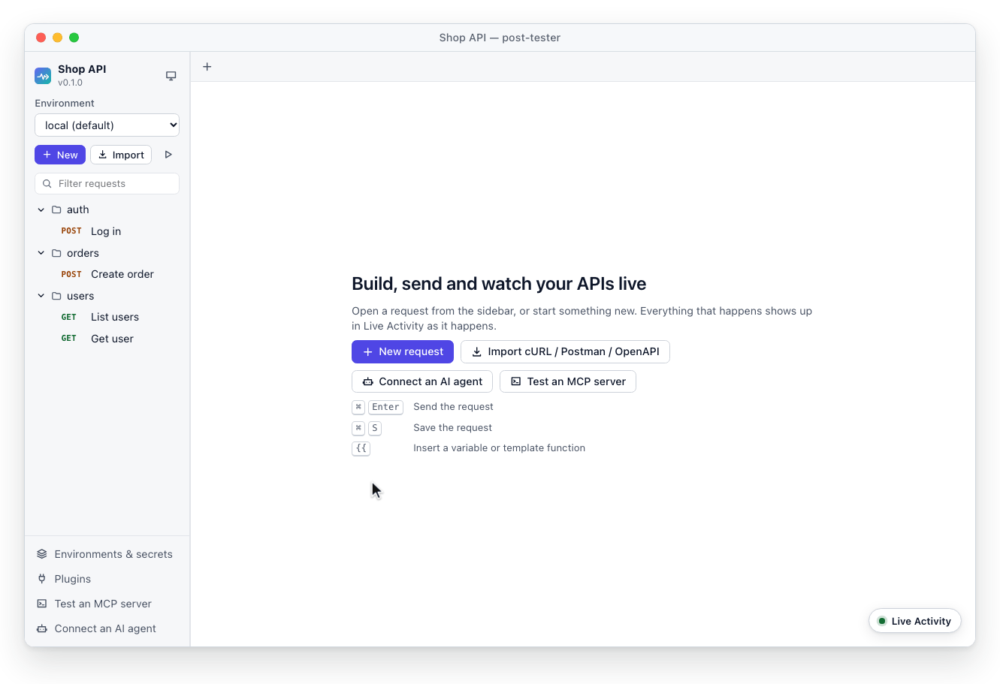
</picture>
</p>

<details>
<summary><b>Tools that agents get</b></summary>
<br>

| Tool | What it does |
|---|---|
| `get_workspace` | Workspace name, environments and the collection tree |
| `get_request` | One saved request |
| `send_request` | Send a saved or inline request; returns status, timing, headers, body, test results and extracted variables |
| `run_collection` | Run a folder and return a summary per request |
| `save_request` | Create or update a request (not available with `--read-only`) |
| `list_environments` | Environment names and variable names |
| `get_recent_activity` | Recent requests and runs, from any source |
| `list_plugins` | Installed plugins and what they provide |
| `<plugin>__<tool>` | Tools provided by plugins |

More in [AI agents and MCP](guide/mcp.md).

</details>

## 🌍 One engine, everywhere

<p>
<picture>
  <source media="(prefers-color-scheme: dark)" srcset="assets/everywhere-dark.svg">
  
</picture>
</p>

| Where | How to start |
|---|---|
| 🖥️ **Desktop app** (macOS, Windows, Linux) | `cargo run -p post-tester-desktop`, or build installers with `cargo tauri build` |
| 🌐 **Browser** | `pt serve` opens the app on localhost |
| ⌨️ **Terminal** | `pt send`, `pt run`, `pt load`, `pt mock` and more ([CLI guide](guide/cli.md)) |
| 🔁 **CI** | `pt run --reporter junit --output results.xml` |
| 🤖 **AI agents** | `pt mcp` over stdio, or `/mcp` over HTTP while the app runs |
| 📱 **Mobile** (iOS, Android) | Experimental: the app is prepared for mobile builds, which are not tested yet |

## 🧱 How it works

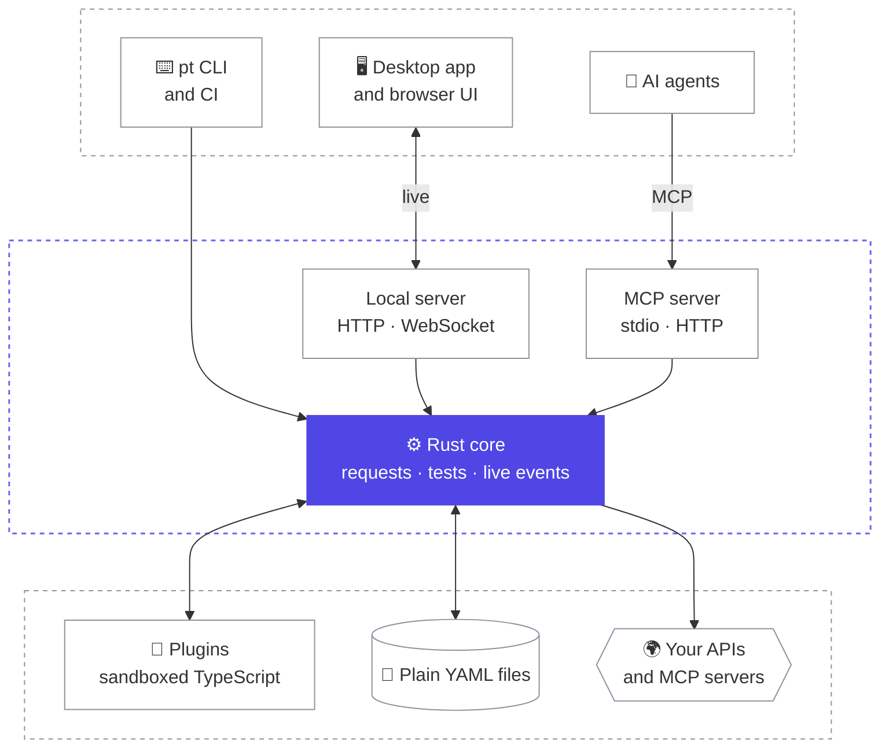

One Rust core sends requests, runs tests and plugins, and reports everything it does as **live events**.
The app, the CLI and the MCP server are thin layers over that core, which is why every surface sees the same thing at the same time.

<details>
<summary><b>Project layout</b></summary>
<br>

| Path | What it is |
|---|---|
| `crates/core` | The engine: requests, live events, tests, runner, import, codegen |
| `crates/plugin-host` | Sandboxed JavaScript runtime for plugins and scripts |
| `crates/mcp` | MCP server (for AI agents) and MCP client (for testing MCP servers) |
| `crates/server` | Local HTTP/WebSocket server that serves the app |
| `crates/cli` | The `pt` command |
| `apps/web` | The web UI |
| `apps/desktop` | The desktop/mobile app (Tauri) |
| `packages/plugin-sdk` | Types and helpers for plugin authors |
| `examples/plugins` | One working example plugin per type |

</details>

## 📚 Documentation

| Guide | Description |
|---|---|
| [Overview](guide/README.md) | Core ideas, concepts and workspace layout |
| [Command line](guide/cli.md) | Every `pt` command, request files, tests and CI |
| [AI agents and MCP](guide/mcp.md) | Connect an AI agent, and test MCP servers |
| [Building plugins](guide/plugins/README.md) | Everything needed to create a plugin, for people and AI agents |
| [Desktop and mobile app](apps/desktop/README.md) | Running and packaging the native app |
| [Local server API](crates/server/API.md) | The HTTP and WebSocket API behind the app |

## 🤝 Contributing

post-tester is at an early stage. Ideas, feedback and issues are welcome.

```bash
cargo test --workspace --exclude post-tester-desktop   # Rust tests
pnpm --filter web test                                 # UI tests
pnpm --filter web dev                                  # UI with hot reload (run `pt serve` too)
```

<details>
<summary><b>🧊 Bonus:</b> GitHub can render 3D models. Open this, then drag to spin the logo.</summary>

```stl
solid post-tester
facet normal 0 0 1
outer loop
vertex 50 50 9
vertex 100 78 9
vertex 98.3 86.4 9
endloop
endfacet
facet normal 0 0 -1
outer loop
vertex 50 50 0
vertex 98.3 86.4 0
vertex 100 78 0
endloop
endfacet
facet normal 1 0.2 0
outer loop
vertex 100 78 0
vertex 98.3 86.4 0
vertex 98.3 86.4 9
endloop
endfacet
facet normal 1 0.2 0
outer loop
vertex 100 78 0
vertex 98.3 86.4 9
vertex 100 78 9
endloop
endfacet
facet normal 0 0 1
outer loop
vertex 50 50 9
vertex 98.3 86.4 9
vertex 93.6 93.6 9
endloop
endfacet
facet normal 0 0 -1
outer loop
vertex 50 50 0
vertex 93.6 93.6 0
vertex 98.3 86.4 0
endloop
endfacet
facet normal 0.8 0.6 0
outer loop
vertex 98.3 86.4 0
vertex 93.6 93.6 0
vertex 93.6 93.6 9
endloop
endfacet
facet normal 0.8 0.6 0
outer loop
vertex 98.3 86.4 0
vertex 93.6 93.6 9
vertex 98.3 86.4 9
endloop
endfacet
facet normal 0 0 1
outer loop
vertex 50 50 9
vertex 93.6 93.6 9
vertex 86.4 98.3 9
endloop
endfacet
facet normal 0 0 -1
outer loop
vertex 50 50 0
vertex 86.4 98.3 0
vertex 93.6 93.6 0
endloop
endfacet
facet normal 0.6 0.8 0
outer loop
vertex 93.6 93.6 0
vertex 86.4 98.3 0
vertex 86.4 98.3 9
endloop
endfacet
facet normal 0.6 0.8 0
outer loop
vertex 93.6 93.6 0
vertex 86.4 98.3 9
vertex 93.6 93.6 9
endloop
endfacet
facet normal 0 0 1
outer loop
vertex 50 50 9
vertex 86.4 98.3 9
vertex 78 100 9
endloop
endfacet
facet normal 0 0 -1
outer loop
vertex 50 50 0
vertex 78 100 0
vertex 86.4 98.3 0
endloop
endfacet
facet normal 0.2 1 0
outer loop
vertex 86.4 98.3 0
vertex 78 100 0
vertex 78 100 9
endloop
endfacet
facet normal 0.2 1 0
outer loop
vertex 86.4 98.3 0
vertex 78 100 9
vertex 86.4 98.3 9
endloop
endfacet
facet normal 0 0 1
outer loop
vertex 50 50 9
vertex 78 100 9
vertex 22 100 9
endloop
endfacet
facet normal 0 0 -1
outer loop
vertex 50 50 0
vertex 22 100 0
vertex 78 100 0
endloop
endfacet
facet normal 0 1 0
outer loop
vertex 78 100 0
vertex 22 100 0
vertex 22 100 9
endloop
endfacet
facet normal 0 1 0
outer loop
vertex 78 100 0
vertex 22 100 9
vertex 78 100 9
endloop
endfacet
facet normal 0 0 1
outer loop
vertex 50 50 9
vertex 22 100 9
vertex 13.6 98.3 9
endloop
endfacet
facet normal 0 0 -1
outer loop
vertex 50 50 0
vertex 13.6 98.3 0
vertex 22 100 0
endloop
endfacet
facet normal -0.2 1 0
outer loop
vertex 22 100 0
vertex 13.6 98.3 0
vertex 13.6 98.3 9
endloop
endfacet
facet normal -0.2 1 0
outer loop
vertex 22 100 0
vertex 13.6 98.3 9
vertex 22 100 9
endloop
endfacet
facet normal 0 0 1
outer loop
vertex 50 50 9
vertex 13.6 98.3 9
vertex 6.4 93.6 9
endloop
endfacet
facet normal 0 0 -1
outer loop
vertex 50 50 0
vertex 6.4 93.6 0
vertex 13.6 98.3 0
endloop
endfacet
facet normal -0.6 0.8 0
outer loop
vertex 13.6 98.3 0
vertex 6.4 93.6 0
vertex 6.4 93.6 9
endloop
endfacet
facet normal -0.6 0.8 0
outer loop
vertex 13.6 98.3 0
vertex 6.4 93.6 9
vertex 13.6 98.3 9
endloop
endfacet
facet normal 0 0 1
outer loop
vertex 50 50 9
vertex 6.4 93.6 9
vertex 1.7 86.4 9
endloop
endfacet
facet normal 0 0 -1
outer loop
vertex 50 50 0
vertex 1.7 86.4 0
vertex 6.4 93.6 0
endloop
endfacet
facet normal -0.8 0.6 0
outer loop
vertex 6.4 93.6 0
vertex 1.7 86.4 0
vertex 1.7 86.4 9
endloop
endfacet
facet normal -0.8 0.6 0
outer loop
vertex 6.4 93.6 0
vertex 1.7 86.4 9
vertex 6.4 93.6 9
endloop
endfacet
facet normal 0 0 1
outer loop
vertex 50 50 9
vertex 1.7 86.4 9
vertex 0 78 9
endloop
endfacet
facet normal 0 0 -1
outer loop
vertex 50 50 0
vertex 0 78 0
vertex 1.7 86.4 0
endloop
endfacet
facet normal -1 0.2 0
outer loop
vertex 1.7 86.4 0
vertex 0 78 0
vertex 0 78 9
endloop
endfacet
facet normal -1 0.2 0
outer loop
vertex 1.7 86.4 0
vertex 0 78 9
vertex 1.7 86.4 9
endloop
endfacet
facet normal 0 0 1
outer loop
vertex 50 50 9
vertex 0 78 9
vertex 0 22 9
endloop
endfacet
facet normal 0 0 -1
outer loop
vertex 50 50 0
vertex 0 22 0
vertex 0 78 0
endloop
endfacet
facet normal -1 0 0
outer loop
vertex 0 78 0
vertex 0 22 0
vertex 0 22 9
endloop
endfacet
facet normal -1 0 0
outer loop
vertex 0 78 0
vertex 0 22 9
vertex 0 78 9
endloop
endfacet
facet normal 0 0 1
outer loop
vertex 50 50 9
vertex 0 22 9
vertex 1.7 13.6 9
endloop
endfacet
facet normal 0 0 -1
outer loop
vertex 50 50 0
vertex 1.7 13.6 0
vertex 0 22 0
endloop
endfacet
facet normal -1 -0.2 0
outer loop
vertex 0 22 0
vertex 1.7 13.6 0
vertex 1.7 13.6 9
endloop
endfacet
facet normal -1 -0.2 0
outer loop
vertex 0 22 0
vertex 1.7 13.6 9
vertex 0 22 9
endloop
endfacet
facet normal 0 0 1
outer loop
vertex 50 50 9
vertex 1.7 13.6 9
vertex 6.4 6.4 9
endloop
endfacet
facet normal 0 0 -1
outer loop
vertex 50 50 0
vertex 6.4 6.4 0
vertex 1.7 13.6 0
endloop
endfacet
facet normal -0.8 -0.6 0
outer loop
vertex 1.7 13.6 0
vertex 6.4 6.4 0
vertex 6.4 6.4 9
endloop
endfacet
facet normal -0.8 -0.6 0
outer loop
vertex 1.7 13.6 0
vertex 6.4 6.4 9
vertex 1.7 13.6 9
endloop
endfacet
facet normal 0 0 1
outer loop
vertex 50 50 9
vertex 6.4 6.4 9
vertex 13.6 1.7 9
endloop
endfacet
facet normal 0 0 -1
outer loop
vertex 50 50 0
vertex 13.6 1.7 0
vertex 6.4 6.4 0
endloop
endfacet
facet normal -0.6 -0.8 0
outer loop
vertex 6.4 6.4 0
vertex 13.6 1.7 0
vertex 13.6 1.7 9
endloop
endfacet
facet normal -0.6 -0.8 0
outer loop
vertex 6.4 6.4 0
vertex 13.6 1.7 9
vertex 6.4 6.4 9
endloop
endfacet
facet normal 0 0 1
outer loop
vertex 50 50 9
vertex 13.6 1.7 9
vertex 22 0 9
endloop
endfacet
facet normal 0 0 -1
outer loop
vertex 50 50 0
vertex 22 0 0
vertex 13.6 1.7 0
endloop
endfacet
facet normal -0.2 -1 0
outer loop
vertex 13.6 1.7 0
vertex 22 0 0
vertex 22 0 9
endloop
endfacet
facet normal -0.2 -1 0
outer loop
vertex 13.6 1.7 0
vertex 22 0 9
vertex 13.6 1.7 9
endloop
endfacet
facet normal 0 0 1
outer loop
vertex 50 50 9
vertex 22 0 9
vertex 78 0 9
endloop
endfacet
facet normal 0 0 -1
outer loop
vertex 50 50 0
vertex 78 0 0
vertex 22 0 0
endloop
endfacet
facet normal 0 -1 0
outer loop
vertex 22 0 0
vertex 78 0 0
vertex 78 0 9
endloop
endfacet
facet normal 0 -1 0
outer loop
vertex 22 0 0
vertex 78 0 9
vertex 22 0 9
endloop
endfacet
facet normal 0 0 1
outer loop
vertex 50 50 9
vertex 78 0 9
vertex 86.4 1.7 9
endloop
endfacet
facet normal 0 0 -1
outer loop
vertex 50 50 0
vertex 86.4 1.7 0
vertex 78 0 0
endloop
endfacet
facet normal 0.2 -1 0
outer loop
vertex 78 0 0
vertex 86.4 1.7 0
vertex 86.4 1.7 9
endloop
endfacet
facet normal 0.2 -1 0
outer loop
vertex 78 0 0
vertex 86.4 1.7 9
vertex 78 0 9
endloop
endfacet
facet normal 0 0 1
outer loop
vertex 50 50 9
vertex 86.4 1.7 9
vertex 93.6 6.4 9
endloop
endfacet
facet normal 0 0 -1
outer loop
vertex 50 50 0
vertex 93.6 6.4 0
vertex 86.4 1.7 0
endloop
endfacet
facet normal 0.6 -0.8 0
outer loop
vertex 86.4 1.7 0
vertex 93.6 6.4 0
vertex 93.6 6.4 9
endloop
endfacet
facet normal 0.6 -0.8 0
outer loop
vertex 86.4 1.7 0
vertex 93.6 6.4 9
vertex 86.4 1.7 9
endloop
endfacet
facet normal 0 0 1
outer loop
vertex 50 50 9
vertex 93.6 6.4 9
vertex 98.3 13.6 9
endloop
endfacet
facet normal 0 0 -1
outer loop
vertex 50 50 0
vertex 98.3 13.6 0
vertex 93.6 6.4 0
endloop
endfacet
facet normal 0.8 -0.6 0
outer loop
vertex 93.6 6.4 0
vertex 98.3 13.6 0
vertex 98.3 13.6 9
endloop
endfacet
facet normal 0.8 -0.6 0
outer loop
vertex 93.6 6.4 0
vertex 98.3 13.6 9
vertex 93.6 6.4 9
endloop
endfacet
facet normal 0 0 1
outer loop
vertex 50 50 9
vertex 98.3 13.6 9
vertex 100 22 9
endloop
endfacet
facet normal 0 0 -1
outer loop
vertex 50 50 0
vertex 100 22 0
vertex 98.3 13.6 0
endloop
endfacet
facet normal 1 -0.2 0
outer loop
vertex 98.3 13.6 0
vertex 100 22 0
vertex 100 22 9
endloop
endfacet
facet normal 1 -0.2 0
outer loop
vertex 98.3 13.6 0
vertex 100 22 9
vertex 98.3 13.6 9
endloop
endfacet
facet normal 0 0 1
outer loop
vertex 50 50 9
vertex 100 22 9
vertex 100 78 9
endloop
endfacet
facet normal 0 0 -1
outer loop
vertex 50 50 0
vertex 100 78 0
vertex 100 22 0
endloop
endfacet
facet normal 1 0 0
outer loop
vertex 100 22 0
vertex 100 78 0
vertex 100 78 9
endloop
endfacet
facet normal 1 0 0
outer loop
vertex 100 22 0
vertex 100 78 9
vertex 100 22 9
endloop
endfacet
facet normal 0 0 1
outer loop
vertex 18 47.8 19
vertex 34 40.3 19
vertex 34 47.8 19
endloop
endfacet
facet normal 0 0 1
outer loop
vertex 18 47.8 19
vertex 18 40.3 19
vertex 34 40.3 19
endloop
endfacet
facet normal 0 1 0
outer loop
vertex 18 47.8 9
vertex 34 47.8 19
vertex 34 47.8 9
endloop
endfacet
facet normal 0 1 0
outer loop
vertex 18 47.8 9
vertex 18 47.8 19
vertex 34 47.8 19
endloop
endfacet
facet normal 0 -1 0
outer loop
vertex 18 40.3 9
vertex 34 40.3 9
vertex 34 40.3 19
endloop
endfacet
facet normal 0 -1 0
outer loop
vertex 18 40.3 9
vertex 34 40.3 19
vertex 18 40.3 19
endloop
endfacet
facet normal 0 0 1
outer loop
vertex 30.6 45.5 19
vertex 45.4 60.5 19
vertex 38.6 63.5 19
endloop
endfacet
facet normal 0 0 1
outer loop
vertex 30.6 45.5 19
vertex 37.4 42.5 19
vertex 45.4 60.5 19
endloop
endfacet
facet normal -0.9 0.4 0
outer loop
vertex 30.6 45.5 9
vertex 38.6 63.5 19
vertex 38.6 63.5 9
endloop
endfacet
facet normal -0.9 0.4 0
outer loop
vertex 30.6 45.5 9
vertex 30.6 45.5 19
vertex 38.6 63.5 19
endloop
endfacet
facet normal 0.9 -0.4 0
outer loop
vertex 37.4 42.5 9
vertex 45.4 60.5 9
vertex 45.4 60.5 19
endloop
endfacet
facet normal 0.9 -0.4 0
outer loop
vertex 37.4 42.5 9
vertex 45.4 60.5 19
vertex 37.4 42.5 19
endloop
endfacet
facet normal 0 0 1
outer loop
vertex 45.6 63.1 19
vertex 48.4 26.9 19
vertex 55.6 29.1 19
endloop
endfacet
facet normal 0 0 1
outer loop
vertex 45.6 63.1 19
vertex 38.4 60.9 19
vertex 48.4 26.9 19
endloop
endfacet
facet normal 1 0.3 0
outer loop
vertex 45.6 63.1 9
vertex 55.6 29.1 19
vertex 55.6 29.1 9
endloop
endfacet
facet normal 1 0.3 0
outer loop
vertex 45.6 63.1 9
vertex 45.6 63.1 19
vertex 55.6 29.1 19
endloop
endfacet
facet normal -1 -0.3 0
outer loop
vertex 38.4 60.9 9
vertex 48.4 26.9 9
vertex 48.4 26.9 19
endloop
endfacet
facet normal -1 -0.3 0
outer loop
vertex 38.4 60.9 9
vertex 48.4 26.9 19
vertex 38.4 60.9 19
endloop
endfacet
facet normal 0 0 1
outer loop
vertex 48.4 29.2 19
vertex 63.6 50.8 19
vertex 56.4 53.2 19
endloop
endfacet
facet normal 0 0 1
outer loop
vertex 48.4 29.2 19
vertex 55.6 26.8 19
vertex 63.6 50.8 19
endloop
endfacet
facet normal -0.9 0.3 0
outer loop
vertex 48.4 29.2 9
vertex 56.4 53.2 19
vertex 56.4 53.2 9
endloop
endfacet
facet normal -0.9 0.3 0
outer loop
vertex 48.4 29.2 9
vertex 48.4 29.2 19
vertex 56.4 53.2 19
endloop
endfacet
facet normal 0.9 -0.3 0
outer loop
vertex 55.6 26.8 9
vertex 63.6 50.8 9
vertex 63.6 50.8 19
endloop
endfacet
facet normal 0.9 -0.3 0
outer loop
vertex 55.6 26.8 9
vertex 63.6 50.8 19
vertex 55.6 26.8 19
endloop
endfacet
facet normal 0 0 1
outer loop
vertex 63 54.3 19
vertex 63 41.8 19
vertex 69 46.3 19
endloop
endfacet
facet normal 0 0 1
outer loop
vertex 63 54.3 19
vertex 57 49.8 19
vertex 63 41.8 19
endloop
endfacet
facet normal 0.8 0.6 0
outer loop
vertex 63 54.3 9
vertex 69 46.3 19
vertex 69 46.3 9
endloop
endfacet
facet normal 0.8 0.6 0
outer loop
vertex 63 54.3 9
vertex 63 54.3 19
vertex 69 46.3 19
endloop
endfacet
facet normal -0.8 -0.6 0
outer loop
vertex 57 49.8 9
vertex 63 41.8 9
vertex 63 41.8 19
endloop
endfacet
facet normal -0.8 -0.6 0
outer loop
vertex 57 49.8 9
vertex 63 41.8 19
vertex 57 49.8 19
endloop
endfacet
facet normal 0 0 1
outer loop
vertex 66 47.8 19
vertex 74 40.3 19
vertex 74 47.8 19
endloop
endfacet
facet normal 0 0 1
outer loop
vertex 66 47.8 19
vertex 66 40.3 19
vertex 74 40.3 19
endloop
endfacet
facet normal 0 1 0
outer loop
vertex 66 47.8 9
vertex 74 47.8 19
vertex 74 47.8 9
endloop
endfacet
facet normal 0 1 0
outer loop
vertex 66 47.8 9
vertex 66 47.8 19
vertex 74 47.8 19
endloop
endfacet
facet normal 0 -1 0
outer loop
vertex 66 40.3 9
vertex 74 40.3 9
vertex 74 40.3 19
endloop
endfacet
facet normal 0 -1 0
outer loop
vertex 66 40.3 9
vertex 74 40.3 19
vertex 66 40.3 19
endloop
endfacet
facet normal 0 0 1
outer loop
vertex 18 44 19.2
vertex 21.8 44 19.2
vertex 21 46.2 19.2
endloop
endfacet
facet normal 1 0.3 0
outer loop
vertex 21.8 44 9
vertex 21 46.2 9
vertex 21 46.2 19.2
endloop
endfacet
facet normal 1 0.3 0
outer loop
vertex 21.8 44 9
vertex 21 46.2 19.2
vertex 21.8 44 19.2
endloop
endfacet
facet normal 0 0 1
outer loop
vertex 18 44 19.2
vertex 21 46.2 19.2
vertex 19.2 47.6 19.2
endloop
endfacet
facet normal 0.6 0.8 0
outer loop
vertex 21 46.2 9
vertex 19.2 47.6 9
vertex 19.2 47.6 19.2
endloop
endfacet
facet normal 0.6 0.8 0
outer loop
vertex 21 46.2 9
vertex 19.2 47.6 19.2
vertex 21 46.2 19.2
endloop
endfacet
facet normal 0 0 1
outer loop
vertex 18 44 19.2
vertex 19.2 47.6 19.2
vertex 16.8 47.6 19.2
endloop
endfacet
facet normal 0 1 0
outer loop
vertex 19.2 47.6 9
vertex 16.8 47.6 9
vertex 16.8 47.6 19.2
endloop
endfacet
facet normal 0 1 0
outer loop
vertex 19.2 47.6 9
vertex 16.8 47.6 19.2
vertex 19.2 47.6 19.2
endloop
endfacet
facet normal 0 0 1
outer loop
vertex 18 44 19.2
vertex 16.8 47.6 19.2
vertex 15 46.2 19.2
endloop
endfacet
facet normal -0.6 0.8 0
outer loop
vertex 16.8 47.6 9
vertex 15 46.2 9
vertex 15 46.2 19.2
endloop
endfacet
facet normal -0.6 0.8 0
outer loop
vertex 16.8 47.6 9
vertex 15 46.2 19.2
vertex 16.8 47.6 19.2
endloop
endfacet
facet normal 0 0 1
outer loop
vertex 18 44 19.2
vertex 15 46.2 19.2
vertex 14.3 44 19.2
endloop
endfacet
facet normal -1 0.3 0
outer loop
vertex 15 46.2 9
vertex 14.3 44 9
vertex 14.3 44 19.2
endloop
endfacet
facet normal -1 0.3 0
outer loop
vertex 15 46.2 9
vertex 14.3 44 19.2
vertex 15 46.2 19.2
endloop
endfacet
facet normal 0 0 1
outer loop
vertex 18 44 19.2
vertex 14.3 44 19.2
vertex 15 41.8 19.2
endloop
endfacet
facet normal -1 -0.3 0
outer loop
vertex 14.3 44 9
vertex 15 41.8 9
vertex 15 41.8 19.2
endloop
endfacet
facet normal -1 -0.3 0
outer loop
vertex 14.3 44 9
vertex 15 41.8 19.2
vertex 14.3 44 19.2
endloop
endfacet
facet normal 0 0 1
outer loop
vertex 18 44 19.2
vertex 15 41.8 19.2
vertex 16.8 40.4 19.2
endloop
endfacet
facet normal -0.6 -0.8 0
outer loop
vertex 15 41.8 9
vertex 16.8 40.4 9
vertex 16.8 40.4 19.2
endloop
endfacet
facet normal -0.6 -0.8 0
outer loop
vertex 15 41.8 9
vertex 16.8 40.4 19.2
vertex 15 41.8 19.2
endloop
endfacet
facet normal 0 0 1
outer loop
vertex 18 44 19.2
vertex 16.8 40.4 19.2
vertex 19.2 40.4 19.2
endloop
endfacet
facet normal 0 -1 0
outer loop
vertex 16.8 40.4 9
vertex 19.2 40.4 9
vertex 19.2 40.4 19.2
endloop
endfacet
facet normal 0 -1 0
outer loop
vertex 16.8 40.4 9
vertex 19.2 40.4 19.2
vertex 16.8 40.4 19.2
endloop
endfacet
facet normal 0 0 1
outer loop
vertex 18 44 19.2
vertex 19.2 40.4 19.2
vertex 21 41.8 19.2
endloop
endfacet
facet normal 0.6 -0.8 0
outer loop
vertex 19.2 40.4 9
vertex 21 41.8 9
vertex 21 41.8 19.2
endloop
endfacet
facet normal 0.6 -0.8 0
outer loop
vertex 19.2 40.4 9
vertex 21 41.8 19.2
vertex 19.2 40.4 19.2
endloop
endfacet
facet normal 0 0 1
outer loop
vertex 18 44 19.2
vertex 21 41.8 19.2
vertex 21.8 44 19.2
endloop
endfacet
facet normal 1 -0.3 0
outer loop
vertex 21 41.8 9
vertex 21.8 44 9
vertex 21.8 44 19.2
endloop
endfacet
facet normal 1 -0.3 0
outer loop
vertex 21 41.8 9
vertex 21.8 44 19.2
vertex 21 41.8 19.2
endloop
endfacet
facet normal 0 0 1
outer loop
vertex 34 44 19.2
vertex 37.8 44 19.2
vertex 37 46.2 19.2
endloop
endfacet
facet normal 1 0.3 0
outer loop
vertex 37.8 44 9
vertex 37 46.2 9
vertex 37 46.2 19.2
endloop
endfacet
facet normal 1 0.3 0
outer loop
vertex 37.8 44 9
vertex 37 46.2 19.2
vertex 37.8 44 19.2
endloop
endfacet
facet normal 0 0 1
outer loop
vertex 34 44 19.2
vertex 37 46.2 19.2
vertex 35.2 47.6 19.2
endloop
endfacet
facet normal 0.6 0.8 0
outer loop
vertex 37 46.2 9
vertex 35.2 47.6 9
vertex 35.2 47.6 19.2
endloop
endfacet
facet normal 0.6 0.8 0
outer loop
vertex 37 46.2 9
vertex 35.2 47.6 19.2
vertex 37 46.2 19.2
endloop
endfacet
facet normal 0 0 1
outer loop
vertex 34 44 19.2
vertex 35.2 47.6 19.2
vertex 32.8 47.6 19.2
endloop
endfacet
facet normal 0 1 0
outer loop
vertex 35.2 47.6 9
vertex 32.8 47.6 9
vertex 32.8 47.6 19.2
endloop
endfacet
facet normal 0 1 0
outer loop
vertex 35.2 47.6 9
vertex 32.8 47.6 19.2
vertex 35.2 47.6 19.2
endloop
endfacet
facet normal 0 0 1
outer loop
vertex 34 44 19.2
vertex 32.8 47.6 19.2
vertex 31 46.2 19.2
endloop
endfacet
facet normal -0.6 0.8 0
outer loop
vertex 32.8 47.6 9
vertex 31 46.2 9
vertex 31 46.2 19.2
endloop
endfacet
facet normal -0.6 0.8 0
outer loop
vertex 32.8 47.6 9
vertex 31 46.2 19.2
vertex 32.8 47.6 19.2
endloop
endfacet
facet normal 0 0 1
outer loop
vertex 34 44 19.2
vertex 31 46.2 19.2
vertex 30.3 44 19.2
endloop
endfacet
facet normal -1 0.3 0
outer loop
vertex 31 46.2 9
vertex 30.3 44 9
vertex 30.3 44 19.2
endloop
endfacet
facet normal -1 0.3 0
outer loop
vertex 31 46.2 9
vertex 30.3 44 19.2
vertex 31 46.2 19.2
endloop
endfacet
facet normal 0 0 1
outer loop
vertex 34 44 19.2
vertex 30.3 44 19.2
vertex 31 41.8 19.2
endloop
endfacet
facet normal -1 -0.3 0
outer loop
vertex 30.3 44 9
vertex 31 41.8 9
vertex 31 41.8 19.2
endloop
endfacet
facet normal -1 -0.3 0
outer loop
vertex 30.3 44 9
vertex 31 41.8 19.2
vertex 30.3 44 19.2
endloop
endfacet
facet normal 0 0 1
outer loop
vertex 34 44 19.2
vertex 31 41.8 19.2
vertex 32.8 40.4 19.2
endloop
endfacet
facet normal -0.6 -0.8 0
outer loop
vertex 31 41.8 9
vertex 32.8 40.4 9
vertex 32.8 40.4 19.2
endloop
endfacet
facet normal -0.6 -0.8 0
outer loop
vertex 31 41.8 9
vertex 32.8 40.4 19.2
vertex 31 41.8 19.2
endloop
endfacet
facet normal 0 0 1
outer loop
vertex 34 44 19.2
vertex 32.8 40.4 19.2
vertex 35.2 40.4 19.2
endloop
endfacet
facet normal 0 -1 0
outer loop
vertex 32.8 40.4 9
vertex 35.2 40.4 9
vertex 35.2 40.4 19.2
endloop
endfacet
facet normal 0 -1 0
outer loop
vertex 32.8 40.4 9
vertex 35.2 40.4 19.2
vertex 32.8 40.4 19.2
endloop
endfacet
facet normal 0 0 1
outer loop
vertex 34 44 19.2
vertex 35.2 40.4 19.2
vertex 37 41.8 19.2
endloop
endfacet
facet normal 0.6 -0.8 0
outer loop
vertex 35.2 40.4 9
vertex 37 41.8 9
vertex 37 41.8 19.2
endloop
endfacet
facet normal 0.6 -0.8 0
outer loop
vertex 35.2 40.4 9
vertex 37 41.8 19.2
vertex 35.2 40.4 19.2
endloop
endfacet
facet normal 0 0 1
outer loop
vertex 34 44 19.2
vertex 37 41.8 19.2
vertex 37.8 44 19.2
endloop
endfacet
facet normal 1 -0.3 0
outer loop
vertex 37 41.8 9
vertex 37.8 44 9
vertex 37.8 44 19.2
endloop
endfacet
facet normal 1 -0.3 0
outer loop
vertex 37 41.8 9
vertex 37.8 44 19.2
vertex 37 41.8 19.2
endloop
endfacet
facet normal 0 0 1
outer loop
vertex 42 62 19.2
vertex 45.8 62 19.2
vertex 45 64.2 19.2
endloop
endfacet
facet normal 1 0.3 0
outer loop
vertex 45.8 62 9
vertex 45 64.2 9
vertex 45 64.2 19.2
endloop
endfacet
facet normal 1 0.3 0
outer loop
vertex 45.8 62 9
vertex 45 64.2 19.2
vertex 45.8 62 19.2
endloop
endfacet
facet normal 0 0 1
outer loop
vertex 42 62 19.2
vertex 45 64.2 19.2
vertex 43.2 65.6 19.2
endloop
endfacet
facet normal 0.6 0.8 0
outer loop
vertex 45 64.2 9
vertex 43.2 65.6 9
vertex 43.2 65.6 19.2
endloop
endfacet
facet normal 0.6 0.8 0
outer loop
vertex 45 64.2 9
vertex 43.2 65.6 19.2
vertex 45 64.2 19.2
endloop
endfacet
facet normal 0 0 1
outer loop
vertex 42 62 19.2
vertex 43.2 65.6 19.2
vertex 40.8 65.6 19.2
endloop
endfacet
facet normal 0 1 0
outer loop
vertex 43.2 65.6 9
vertex 40.8 65.6 9
vertex 40.8 65.6 19.2
endloop
endfacet
facet normal 0 1 0
outer loop
vertex 43.2 65.6 9
vertex 40.8 65.6 19.2
vertex 43.2 65.6 19.2
endloop
endfacet
facet normal 0 0 1
outer loop
vertex 42 62 19.2
vertex 40.8 65.6 19.2
vertex 39 64.2 19.2
endloop
endfacet
facet normal -0.6 0.8 0
outer loop
vertex 40.8 65.6 9
vertex 39 64.2 9
vertex 39 64.2 19.2
endloop
endfacet
facet normal -0.6 0.8 0
outer loop
vertex 40.8 65.6 9
vertex 39 64.2 19.2
vertex 40.8 65.6 19.2
endloop
endfacet
facet normal 0 0 1
outer loop
vertex 42 62 19.2
vertex 39 64.2 19.2
vertex 38.3 62 19.2
endloop
endfacet
facet normal -1 0.3 0
outer loop
vertex 39 64.2 9
vertex 38.3 62 9
vertex 38.3 62 19.2
endloop
endfacet
facet normal -1 0.3 0
outer loop
vertex 39 64.2 9
vertex 38.3 62 19.2
vertex 39 64.2 19.2
endloop
endfacet
facet normal 0 0 1
outer loop
vertex 42 62 19.2
vertex 38.3 62 19.2
vertex 39 59.8 19.2
endloop
endfacet
facet normal -1 -0.3 0
outer loop
vertex 38.3 62 9
vertex 39 59.8 9
vertex 39 59.8 19.2
endloop
endfacet
facet normal -1 -0.3 0
outer loop
vertex 38.3 62 9
vertex 39 59.8 19.2
vertex 38.3 62 19.2
endloop
endfacet
facet normal 0 0 1
outer loop
vertex 42 62 19.2
vertex 39 59.8 19.2
vertex 40.8 58.4 19.2
endloop
endfacet
facet normal -0.6 -0.8 0
outer loop
vertex 39 59.8 9
vertex 40.8 58.4 9
vertex 40.8 58.4 19.2
endloop
endfacet
facet normal -0.6 -0.8 0
outer loop
vertex 39 59.8 9
vertex 40.8 58.4 19.2
vertex 39 59.8 19.2
endloop
endfacet
facet normal 0 0 1
outer loop
vertex 42 62 19.2
vertex 40.8 58.4 19.2
vertex 43.2 58.4 19.2
endloop
endfacet
facet normal 0 -1 0
outer loop
vertex 40.8 58.4 9
vertex 43.2 58.4 9
vertex 43.2 58.4 19.2
endloop
endfacet
facet normal 0 -1 0
outer loop
vertex 40.8 58.4 9
vertex 43.2 58.4 19.2
vertex 40.8 58.4 19.2
endloop
endfacet
facet normal 0 0 1
outer loop
vertex 42 62 19.2
vertex 43.2 58.4 19.2
vertex 45 59.8 19.2
endloop
endfacet
facet normal 0.6 -0.8 0
outer loop
vertex 43.2 58.4 9
vertex 45 59.8 9
vertex 45 59.8 19.2
endloop
endfacet
facet normal 0.6 -0.8 0
outer loop
vertex 43.2 58.4 9
vertex 45 59.8 19.2
vertex 43.2 58.4 19.2
endloop
endfacet
facet normal 0 0 1
outer loop
vertex 42 62 19.2
vertex 45 59.8 19.2
vertex 45.8 62 19.2
endloop
endfacet
facet normal 1 -0.3 0
outer loop
vertex 45 59.8 9
vertex 45.8 62 9
vertex 45.8 62 19.2
endloop
endfacet
facet normal 1 -0.3 0
outer loop
vertex 45 59.8 9
vertex 45.8 62 19.2
vertex 45 59.8 19.2
endloop
endfacet
facet normal 0 0 1
outer loop
vertex 52 28 19.2
vertex 55.8 28 19.2
vertex 55 30.2 19.2
endloop
endfacet
facet normal 1 0.3 0
outer loop
vertex 55.8 28 9
vertex 55 30.2 9
vertex 55 30.2 19.2
endloop
endfacet
facet normal 1 0.3 0
outer loop
vertex 55.8 28 9
vertex 55 30.2 19.2
vertex 55.8 28 19.2
endloop
endfacet
facet normal 0 0 1
outer loop
vertex 52 28 19.2
vertex 55 30.2 19.2
vertex 53.2 31.6 19.2
endloop
endfacet
facet normal 0.6 0.8 0
outer loop
vertex 55 30.2 9
vertex 53.2 31.6 9
vertex 53.2 31.6 19.2
endloop
endfacet
facet normal 0.6 0.8 0
outer loop
vertex 55 30.2 9
vertex 53.2 31.6 19.2
vertex 55 30.2 19.2
endloop
endfacet
facet normal 0 0 1
outer loop
vertex 52 28 19.2
vertex 53.2 31.6 19.2
vertex 50.8 31.6 19.2
endloop
endfacet
facet normal 0 1 0
outer loop
vertex 53.2 31.6 9
vertex 50.8 31.6 9
vertex 50.8 31.6 19.2
endloop
endfacet
facet normal 0 1 0
outer loop
vertex 53.2 31.6 9
vertex 50.8 31.6 19.2
vertex 53.2 31.6 19.2
endloop
endfacet
facet normal 0 0 1
outer loop
vertex 52 28 19.2
vertex 50.8 31.6 19.2
vertex 49 30.2 19.2
endloop
endfacet
facet normal -0.6 0.8 0
outer loop
vertex 50.8 31.6 9
vertex 49 30.2 9
vertex 49 30.2 19.2
endloop
endfacet
facet normal -0.6 0.8 0
outer loop
vertex 50.8 31.6 9
vertex 49 30.2 19.2
vertex 50.8 31.6 19.2
endloop
endfacet
facet normal 0 0 1
outer loop
vertex 52 28 19.2
vertex 49 30.2 19.2
vertex 48.3 28 19.2
endloop
endfacet
facet normal -1 0.3 0
outer loop
vertex 49 30.2 9
vertex 48.3 28 9
vertex 48.3 28 19.2
endloop
endfacet
facet normal -1 0.3 0
outer loop
vertex 49 30.2 9
vertex 48.3 28 19.2
vertex 49 30.2 19.2
endloop
endfacet
facet normal 0 0 1
outer loop
vertex 52 28 19.2
vertex 48.3 28 19.2
vertex 49 25.8 19.2
endloop
endfacet
facet normal -1 -0.3 0
outer loop
vertex 48.3 28 9
vertex 49 25.8 9
vertex 49 25.8 19.2
endloop
endfacet
facet normal -1 -0.3 0
outer loop
vertex 48.3 28 9
vertex 49 25.8 19.2
vertex 48.3 28 19.2
endloop
endfacet
facet normal 0 0 1
outer loop
vertex 52 28 19.2
vertex 49 25.8 19.2
vertex 50.8 24.4 19.2
endloop
endfacet
facet normal -0.6 -0.8 0
outer loop
vertex 49 25.8 9
vertex 50.8 24.4 9
vertex 50.8 24.4 19.2
endloop
endfacet
facet normal -0.6 -0.8 0
outer loop
vertex 49 25.8 9
vertex 50.8 24.4 19.2
vertex 49 25.8 19.2
endloop
endfacet
facet normal 0 0 1
outer loop
vertex 52 28 19.2
vertex 50.8 24.4 19.2
vertex 53.2 24.4 19.2
endloop
endfacet
facet normal 0 -1 0
outer loop
vertex 50.8 24.4 9
vertex 53.2 24.4 9
vertex 53.2 24.4 19.2
endloop
endfacet
facet normal 0 -1 0
outer loop
vertex 50.8 24.4 9
vertex 53.2 24.4 19.2
vertex 50.8 24.4 19.2
endloop
endfacet
facet normal 0 0 1
outer loop
vertex 52 28 19.2
vertex 53.2 24.4 19.2
vertex 55 25.8 19.2
endloop
endfacet
facet normal 0.6 -0.8 0
outer loop
vertex 53.2 24.4 9
vertex 55 25.8 9
vertex 55 25.8 19.2
endloop
endfacet
facet normal 0.6 -0.8 0
outer loop
vertex 53.2 24.4 9
vertex 55 25.8 19.2
vertex 53.2 24.4 19.2
endloop
endfacet
facet normal 0 0 1
outer loop
vertex 52 28 19.2
vertex 55 25.8 19.2
vertex 55.8 28 19.2
endloop
endfacet
facet normal 1 -0.3 0
outer loop
vertex 55 25.8 9
vertex 55.8 28 9
vertex 55.8 28 19.2
endloop
endfacet
facet normal 1 -0.3 0
outer loop
vertex 55 25.8 9
vertex 55.8 28 19.2
vertex 55 25.8 19.2
endloop
endfacet
facet normal 0 0 1
outer loop
vertex 60 52 19.2
vertex 63.8 52 19.2
vertex 63 54.2 19.2
endloop
endfacet
facet normal 1 0.3 0
outer loop
vertex 63.8 52 9
vertex 63 54.2 9
vertex 63 54.2 19.2
endloop
endfacet
facet normal 1 0.3 0
outer loop
vertex 63.8 52 9
vertex 63 54.2 19.2
vertex 63.8 52 19.2
endloop
endfacet
facet normal 0 0 1
outer loop
vertex 60 52 19.2
vertex 63 54.2 19.2
vertex 61.2 55.6 19.2
endloop
endfacet
facet normal 0.6 0.8 0
outer loop
vertex 63 54.2 9
vertex 61.2 55.6 9
vertex 61.2 55.6 19.2
endloop
endfacet
facet normal 0.6 0.8 0
outer loop
vertex 63 54.2 9
vertex 61.2 55.6 19.2
vertex 63 54.2 19.2
endloop
endfacet
facet normal 0 0 1
outer loop
vertex 60 52 19.2
vertex 61.2 55.6 19.2
vertex 58.8 55.6 19.2
endloop
endfacet
facet normal 0 1 0
outer loop
vertex 61.2 55.6 9
vertex 58.8 55.6 9
vertex 58.8 55.6 19.2
endloop
endfacet
facet normal 0 1 0
outer loop
vertex 61.2 55.6 9
vertex 58.8 55.6 19.2
vertex 61.2 55.6 19.2
endloop
endfacet
facet normal 0 0 1
outer loop
vertex 60 52 19.2
vertex 58.8 55.6 19.2
vertex 57 54.2 19.2
endloop
endfacet
facet normal -0.6 0.8 0
outer loop
vertex 58.8 55.6 9
vertex 57 54.2 9
vertex 57 54.2 19.2
endloop
endfacet
facet normal -0.6 0.8 0
outer loop
vertex 58.8 55.6 9
vertex 57 54.2 19.2
vertex 58.8 55.6 19.2
endloop
endfacet
facet normal 0 0 1
outer loop
vertex 60 52 19.2
vertex 57 54.2 19.2
vertex 56.3 52 19.2
endloop
endfacet
facet normal -1 0.3 0
outer loop
vertex 57 54.2 9
vertex 56.3 52 9
vertex 56.3 52 19.2
endloop
endfacet
facet normal -1 0.3 0
outer loop
vertex 57 54.2 9
vertex 56.3 52 19.2
vertex 57 54.2 19.2
endloop
endfacet
facet normal 0 0 1
outer loop
vertex 60 52 19.2
vertex 56.3 52 19.2
vertex 57 49.8 19.2
endloop
endfacet
facet normal -1 -0.3 0
outer loop
vertex 56.3 52 9
vertex 57 49.8 9
vertex 57 49.8 19.2
endloop
endfacet
facet normal -1 -0.3 0
outer loop
vertex 56.3 52 9
vertex 57 49.8 19.2
vertex 56.3 52 19.2
endloop
endfacet
facet normal 0 0 1
outer loop
vertex 60 52 19.2
vertex 57 49.8 19.2
vertex 58.8 48.4 19.2
endloop
endfacet
facet normal -0.6 -0.8 0
outer loop
vertex 57 49.8 9
vertex 58.8 48.4 9
vertex 58.8 48.4 19.2
endloop
endfacet
facet normal -0.6 -0.8 0
outer loop
vertex 57 49.8 9
vertex 58.8 48.4 19.2
vertex 57 49.8 19.2
endloop
endfacet
facet normal 0 0 1
outer loop
vertex 60 52 19.2
vertex 58.8 48.4 19.2
vertex 61.2 48.4 19.2
endloop
endfacet
facet normal 0 -1 0
outer loop
vertex 58.8 48.4 9
vertex 61.2 48.4 9
vertex 61.2 48.4 19.2
endloop
endfacet
facet normal 0 -1 0
outer loop
vertex 58.8 48.4 9
vertex 61.2 48.4 19.2
vertex 58.8 48.4 19.2
endloop
endfacet
facet normal 0 0 1
outer loop
vertex 60 52 19.2
vertex 61.2 48.4 19.2
vertex 63 49.8 19.2
endloop
endfacet
facet normal 0.6 -0.8 0
outer loop
vertex 61.2 48.4 9
vertex 63 49.8 9
vertex 63 49.8 19.2
endloop
endfacet
facet normal 0.6 -0.8 0
outer loop
vertex 61.2 48.4 9
vertex 63 49.8 19.2
vertex 61.2 48.4 19.2
endloop
endfacet
facet normal 0 0 1
outer loop
vertex 60 52 19.2
vertex 63 49.8 19.2
vertex 63.8 52 19.2
endloop
endfacet
facet normal 1 -0.3 0
outer loop
vertex 63 49.8 9
vertex 63.8 52 9
vertex 63.8 52 19.2
endloop
endfacet
facet normal 1 -0.3 0
outer loop
vertex 63 49.8 9
vertex 63.8 52 19.2
vertex 63 49.8 19.2
endloop
endfacet
facet normal 0 0 1
outer loop
vertex 66 44 19.2
vertex 69.8 44 19.2
vertex 69 46.2 19.2
endloop
endfacet
facet normal 1 0.3 0
outer loop
vertex 69.8 44 9
vertex 69 46.2 9
vertex 69 46.2 19.2
endloop
endfacet
facet normal 1 0.3 0
outer loop
vertex 69.8 44 9
vertex 69 46.2 19.2
vertex 69.8 44 19.2
endloop
endfacet
facet normal 0 0 1
outer loop
vertex 66 44 19.2
vertex 69 46.2 19.2
vertex 67.2 47.6 19.2
endloop
endfacet
facet normal 0.6 0.8 0
outer loop
vertex 69 46.2 9
vertex 67.2 47.6 9
vertex 67.2 47.6 19.2
endloop
endfacet
facet normal 0.6 0.8 0
outer loop
vertex 69 46.2 9
vertex 67.2 47.6 19.2
vertex 69 46.2 19.2
endloop
endfacet
facet normal 0 0 1
outer loop
vertex 66 44 19.2
vertex 67.2 47.6 19.2
vertex 64.8 47.6 19.2
endloop
endfacet
facet normal 0 1 0
outer loop
vertex 67.2 47.6 9
vertex 64.8 47.6 9
vertex 64.8 47.6 19.2
endloop
endfacet
facet normal 0 1 0
outer loop
vertex 67.2 47.6 9
vertex 64.8 47.6 19.2
vertex 67.2 47.6 19.2
endloop
endfacet
facet normal 0 0 1
outer loop
vertex 66 44 19.2
vertex 64.8 47.6 19.2
vertex 63 46.2 19.2
endloop
endfacet
facet normal -0.6 0.8 0
outer loop
vertex 64.8 47.6 9
vertex 63 46.2 9
vertex 63 46.2 19.2
endloop
endfacet
facet normal -0.6 0.8 0
outer loop
vertex 64.8 47.6 9
vertex 63 46.2 19.2
vertex 64.8 47.6 19.2
endloop
endfacet
facet normal 0 0 1
outer loop
vertex 66 44 19.2
vertex 63 46.2 19.2
vertex 62.3 44 19.2
endloop
endfacet
facet normal -1 0.3 0
outer loop
vertex 63 46.2 9
vertex 62.3 44 9
vertex 62.3 44 19.2
endloop
endfacet
facet normal -1 0.3 0
outer loop
vertex 63 46.2 9
vertex 62.3 44 19.2
vertex 63 46.2 19.2
endloop
endfacet
facet normal 0 0 1
outer loop
vertex 66 44 19.2
vertex 62.3 44 19.2
vertex 63 41.8 19.2
endloop
endfacet
facet normal -1 -0.3 0
outer loop
vertex 62.3 44 9
vertex 63 41.8 9
vertex 63 41.8 19.2
endloop
endfacet
facet normal -1 -0.3 0
outer loop
vertex 62.3 44 9
vertex 63 41.8 19.2
vertex 62.3 44 19.2
endloop
endfacet
facet normal 0 0 1
outer loop
vertex 66 44 19.2
vertex 63 41.8 19.2
vertex 64.8 40.4 19.2
endloop
endfacet
facet normal -0.6 -0.8 0
outer loop
vertex 63 41.8 9
vertex 64.8 40.4 9
vertex 64.8 40.4 19.2
endloop
endfacet
facet normal -0.6 -0.8 0
outer loop
vertex 63 41.8 9
vertex 64.8 40.4 19.2
vertex 63 41.8 19.2
endloop
endfacet
facet normal 0 0 1
outer loop
vertex 66 44 19.2
vertex 64.8 40.4 19.2
vertex 67.2 40.4 19.2
endloop
endfacet
facet normal 0 -1 0
outer loop
vertex 64.8 40.4 9
vertex 67.2 40.4 9
vertex 67.2 40.4 19.2
endloop
endfacet
facet normal 0 -1 0
outer loop
vertex 64.8 40.4 9
vertex 67.2 40.4 19.2
vertex 64.8 40.4 19.2
endloop
endfacet
facet normal 0 0 1
outer loop
vertex 66 44 19.2
vertex 67.2 40.4 19.2
vertex 69 41.8 19.2
endloop
endfacet
facet normal 0.6 -0.8 0
outer loop
vertex 67.2 40.4 9
vertex 69 41.8 9
vertex 69 41.8 19.2
endloop
endfacet
facet normal 0.6 -0.8 0
outer loop
vertex 67.2 40.4 9
vertex 69 41.8 19.2
vertex 67.2 40.4 19.2
endloop
endfacet
facet normal 0 0 1
outer loop
vertex 66 44 19.2
vertex 69 41.8 19.2
vertex 69.8 44 19.2
endloop
endfacet
facet normal 1 -0.3 0
outer loop
vertex 69 41.8 9
vertex 69.8 44 9
vertex 69.8 44 19.2
endloop
endfacet
facet normal 1 -0.3 0
outer loop
vertex 69 41.8 9
vertex 69.8 44 19.2
vertex 69 41.8 19.2
endloop
endfacet
facet normal 0 0 1
outer loop
vertex 74 44 19.2
vertex 77.8 44 19.2
vertex 77 46.2 19.2
endloop
endfacet
facet normal 1 0.3 0
outer loop
vertex 77.8 44 9
vertex 77 46.2 9
vertex 77 46.2 19.2
endloop
endfacet
facet normal 1 0.3 0
outer loop
vertex 77.8 44 9
vertex 77 46.2 19.2
vertex 77.8 44 19.2
endloop
endfacet
facet normal 0 0 1
outer loop
vertex 74 44 19.2
vertex 77 46.2 19.2
vertex 75.2 47.6 19.2
endloop
endfacet
facet normal 0.6 0.8 0
outer loop
vertex 77 46.2 9
vertex 75.2 47.6 9
vertex 75.2 47.6 19.2
endloop
endfacet
facet normal 0.6 0.8 0
outer loop
vertex 77 46.2 9
vertex 75.2 47.6 19.2
vertex 77 46.2 19.2
endloop
endfacet
facet normal 0 0 1
outer loop
vertex 74 44 19.2
vertex 75.2 47.6 19.2
vertex 72.8 47.6 19.2
endloop
endfacet
facet normal 0 1 0
outer loop
vertex 75.2 47.6 9
vertex 72.8 47.6 9
vertex 72.8 47.6 19.2
endloop
endfacet
facet normal 0 1 0
outer loop
vertex 75.2 47.6 9
vertex 72.8 47.6 19.2
vertex 75.2 47.6 19.2
endloop
endfacet
facet normal 0 0 1
outer loop
vertex 74 44 19.2
vertex 72.8 47.6 19.2
vertex 71 46.2 19.2
endloop
endfacet
facet normal -0.6 0.8 0
outer loop
vertex 72.8 47.6 9
vertex 71 46.2 9
vertex 71 46.2 19.2
endloop
endfacet
facet normal -0.6 0.8 0
outer loop
vertex 72.8 47.6 9
vertex 71 46.2 19.2
vertex 72.8 47.6 19.2
endloop
endfacet
facet normal 0 0 1
outer loop
vertex 74 44 19.2
vertex 71 46.2 19.2
vertex 70.3 44 19.2
endloop
endfacet
facet normal -1 0.3 0
outer loop
vertex 71 46.2 9
vertex 70.3 44 9
vertex 70.3 44 19.2
endloop
endfacet
facet normal -1 0.3 0
outer loop
vertex 71 46.2 9
vertex 70.3 44 19.2
vertex 71 46.2 19.2
endloop
endfacet
facet normal 0 0 1
outer loop
vertex 74 44 19.2
vertex 70.3 44 19.2
vertex 71 41.8 19.2
endloop
endfacet
facet normal -1 -0.3 0
outer loop
vertex 70.3 44 9
vertex 71 41.8 9
vertex 71 41.8 19.2
endloop
endfacet
facet normal -1 -0.3 0
outer loop
vertex 70.3 44 9
vertex 71 41.8 19.2
vertex 70.3 44 19.2
endloop
endfacet
facet normal 0 0 1
outer loop
vertex 74 44 19.2
vertex 71 41.8 19.2
vertex 72.8 40.4 19.2
endloop
endfacet
facet normal -0.6 -0.8 0
outer loop
vertex 71 41.8 9
vertex 72.8 40.4 9
vertex 72.8 40.4 19.2
endloop
endfacet
facet normal -0.6 -0.8 0
outer loop
vertex 71 41.8 9
vertex 72.8 40.4 19.2
vertex 71 41.8 19.2
endloop
endfacet
facet normal 0 0 1
outer loop
vertex 74 44 19.2
vertex 72.8 40.4 19.2
vertex 75.2 40.4 19.2
endloop
endfacet
facet normal 0 -1 0
outer loop
vertex 72.8 40.4 9
vertex 75.2 40.4 9
vertex 75.2 40.4 19.2
endloop
endfacet
facet normal 0 -1 0
outer loop
vertex 72.8 40.4 9
vertex 75.2 40.4 19.2
vertex 72.8 40.4 19.2
endloop
endfacet
facet normal 0 0 1
outer loop
vertex 74 44 19.2
vertex 75.2 40.4 19.2
vertex 77 41.8 19.2
endloop
endfacet
facet normal 0.6 -0.8 0
outer loop
vertex 75.2 40.4 9
vertex 77 41.8 9
vertex 77 41.8 19.2
endloop
endfacet
facet normal 0.6 -0.8 0
outer loop
vertex 75.2 40.4 9
vertex 77 41.8 19.2
vertex 75.2 40.4 19.2
endloop
endfacet
facet normal 0 0 1
outer loop
vertex 74 44 19.2
vertex 77 41.8 19.2
vertex 77.8 44 19.2
endloop
endfacet
facet normal 1 -0.3 0
outer loop
vertex 77 41.8 9
vertex 77.8 44 9
vertex 77.8 44 19.2
endloop
endfacet
facet normal 1 -0.3 0
outer loop
vertex 77 41.8 9
vertex 77.8 44 19.2
vertex 77 41.8 19.2
endloop
endfacet
facet normal 0 0 1
outer loop
vertex 72.7 60.7 19
vertex 81.3 41.3 19
vertex 86.7 46.7 19
endloop
endfacet
facet normal 0 0 1
outer loop
vertex 72.7 60.7 19
vertex 67.3 55.3 19
vertex 81.3 41.3 19
endloop
endfacet
facet normal 0.7 0.7 0
outer loop
vertex 72.7 60.7 9
vertex 86.7 46.7 19
vertex 86.7 46.7 9
endloop
endfacet
facet normal 0.7 0.7 0
outer loop
vertex 72.7 60.7 9
vertex 72.7 60.7 19
vertex 86.7 46.7 19
endloop
endfacet
facet normal -0.7 -0.7 0
outer loop
vertex 67.3 55.3 9
vertex 81.3 41.3 9
vertex 81.3 41.3 19
endloop
endfacet
facet normal -0.7 -0.7 0
outer loop
vertex 67.3 55.3 9
vertex 81.3 41.3 19
vertex 67.3 55.3 19
endloop
endfacet
facet normal 0 0 1
outer loop
vertex 86.7 41.3 19
vertex 67.3 32.7 19
vertex 72.7 27.3 19
endloop
endfacet
facet normal 0 0 1
outer loop
vertex 86.7 41.3 19
vertex 81.3 46.7 19
vertex 67.3 32.7 19
endloop
endfacet
facet normal 0.7 -0.7 0
outer loop
vertex 86.7 41.3 9
vertex 72.7 27.3 19
vertex 72.7 27.3 9
endloop
endfacet
facet normal 0.7 -0.7 0
outer loop
vertex 86.7 41.3 9
vertex 86.7 41.3 19
vertex 72.7 27.3 19
endloop
endfacet
facet normal -0.7 0.7 0
outer loop
vertex 81.3 46.7 9
vertex 67.3 32.7 9
vertex 67.3 32.7 19
endloop
endfacet
facet normal -0.7 0.7 0
outer loop
vertex 81.3 46.7 9
vertex 67.3 32.7 19
vertex 81.3 46.7 19
endloop
endfacet
facet normal 0 0 1
outer loop
vertex 70 58 19.2
vertex 73.8 58 19.2
vertex 73 60.2 19.2
endloop
endfacet
facet normal 1 0.3 0
outer loop
vertex 73.8 58 9
vertex 73 60.2 9
vertex 73 60.2 19.2
endloop
endfacet
facet normal 1 0.3 0
outer loop
vertex 73.8 58 9
vertex 73 60.2 19.2
vertex 73.8 58 19.2
endloop
endfacet
facet normal 0 0 1
outer loop
vertex 70 58 19.2
vertex 73 60.2 19.2
vertex 71.2 61.6 19.2
endloop
endfacet
facet normal 0.6 0.8 0
outer loop
vertex 73 60.2 9
vertex 71.2 61.6 9
vertex 71.2 61.6 19.2
endloop
endfacet
facet normal 0.6 0.8 0
outer loop
vertex 73 60.2 9
vertex 71.2 61.6 19.2
vertex 73 60.2 19.2
endloop
endfacet
facet normal 0 0 1
outer loop
vertex 70 58 19.2
vertex 71.2 61.6 19.2
vertex 68.8 61.6 19.2
endloop
endfacet
facet normal 0 1 0
outer loop
vertex 71.2 61.6 9
vertex 68.8 61.6 9
vertex 68.8 61.6 19.2
endloop
endfacet
facet normal 0 1 0
outer loop
vertex 71.2 61.6 9
vertex 68.8 61.6 19.2
vertex 71.2 61.6 19.2
endloop
endfacet
facet normal 0 0 1
outer loop
vertex 70 58 19.2
vertex 68.8 61.6 19.2
vertex 67 60.2 19.2
endloop
endfacet
facet normal -0.6 0.8 0
outer loop
vertex 68.8 61.6 9
vertex 67 60.2 9
vertex 67 60.2 19.2
endloop
endfacet
facet normal -0.6 0.8 0
outer loop
vertex 68.8 61.6 9
vertex 67 60.2 19.2
vertex 68.8 61.6 19.2
endloop
endfacet
facet normal 0 0 1
outer loop
vertex 70 58 19.2
vertex 67 60.2 19.2
vertex 66.3 58 19.2
endloop
endfacet
facet normal -1 0.3 0
outer loop
vertex 67 60.2 9
vertex 66.3 58 9
vertex 66.3 58 19.2
endloop
endfacet
facet normal -1 0.3 0
outer loop
vertex 67 60.2 9
vertex 66.3 58 19.2
vertex 67 60.2 19.2
endloop
endfacet
facet normal 0 0 1
outer loop
vertex 70 58 19.2
vertex 66.3 58 19.2
vertex 67 55.8 19.2
endloop
endfacet
facet normal -1 -0.3 0
outer loop
vertex 66.3 58 9
vertex 67 55.8 9
vertex 67 55.8 19.2
endloop
endfacet
facet normal -1 -0.3 0
outer loop
vertex 66.3 58 9
vertex 67 55.8 19.2
vertex 66.3 58 19.2
endloop
endfacet
facet normal 0 0 1
outer loop
vertex 70 58 19.2
vertex 67 55.8 19.2
vertex 68.8 54.4 19.2
endloop
endfacet
facet normal -0.6 -0.8 0
outer loop
vertex 67 55.8 9
vertex 68.8 54.4 9
vertex 68.8 54.4 19.2
endloop
endfacet
facet normal -0.6 -0.8 0
outer loop
vertex 67 55.8 9
vertex 68.8 54.4 19.2
vertex 67 55.8 19.2
endloop
endfacet
facet normal 0 0 1
outer loop
vertex 70 58 19.2
vertex 68.8 54.4 19.2
vertex 71.2 54.4 19.2
endloop
endfacet
facet normal 0 -1 0
outer loop
vertex 68.8 54.4 9
vertex 71.2 54.4 9
vertex 71.2 54.4 19.2
endloop
endfacet
facet normal 0 -1 0
outer loop
vertex 68.8 54.4 9
vertex 71.2 54.4 19.2
vertex 68.8 54.4 19.2
endloop
endfacet
facet normal 0 0 1
outer loop
vertex 70 58 19.2
vertex 71.2 54.4 19.2
vertex 73 55.8 19.2
endloop
endfacet
facet normal 0.6 -0.8 0
outer loop
vertex 71.2 54.4 9
vertex 73 55.8 9
vertex 73 55.8 19.2
endloop
endfacet
facet normal 0.6 -0.8 0
outer loop
vertex 71.2 54.4 9
vertex 73 55.8 19.2
vertex 71.2 54.4 19.2
endloop
endfacet
facet normal 0 0 1
outer loop
vertex 70 58 19.2
vertex 73 55.8 19.2
vertex 73.8 58 19.2
endloop
endfacet
facet normal 1 -0.3 0
outer loop
vertex 73 55.8 9
vertex 73.8 58 9
vertex 73.8 58 19.2
endloop
endfacet
facet normal 1 -0.3 0
outer loop
vertex 73 55.8 9
vertex 73.8 58 19.2
vertex 73 55.8 19.2
endloop
endfacet
facet normal 0 0 1
outer loop
vertex 84 44 19.2
vertex 87.8 44 19.2
vertex 87 46.2 19.2
endloop
endfacet
facet normal 1 0.3 0
outer loop
vertex 87.8 44 9
vertex 87 46.2 9
vertex 87 46.2 19.2
endloop
endfacet
facet normal 1 0.3 0
outer loop
vertex 87.8 44 9
vertex 87 46.2 19.2
vertex 87.8 44 19.2
endloop
endfacet
facet normal 0 0 1
outer loop
vertex 84 44 19.2
vertex 87 46.2 19.2
vertex 85.2 47.6 19.2
endloop
endfacet
facet normal 0.6 0.8 0
outer loop
vertex 87 46.2 9
vertex 85.2 47.6 9
vertex 85.2 47.6 19.2
endloop
endfacet
facet normal 0.6 0.8 0
outer loop
vertex 87 46.2 9
vertex 85.2 47.6 19.2
vertex 87 46.2 19.2
endloop
endfacet
facet normal 0 0 1
outer loop
vertex 84 44 19.2
vertex 85.2 47.6 19.2
vertex 82.8 47.6 19.2
endloop
endfacet
facet normal 0 1 0
outer loop
vertex 85.2 47.6 9
vertex 82.8 47.6 9
vertex 82.8 47.6 19.2
endloop
endfacet
facet normal 0 1 0
outer loop
vertex 85.2 47.6 9
vertex 82.8 47.6 19.2
vertex 85.2 47.6 19.2
endloop
endfacet
facet normal 0 0 1
outer loop
vertex 84 44 19.2
vertex 82.8 47.6 19.2
vertex 81 46.2 19.2
endloop
endfacet
facet normal -0.6 0.8 0
outer loop
vertex 82.8 47.6 9
vertex 81 46.2 9
vertex 81 46.2 19.2
endloop
endfacet
facet normal -0.6 0.8 0
outer loop
vertex 82.8 47.6 9
vertex 81 46.2 19.2
vertex 82.8 47.6 19.2
endloop
endfacet
facet normal 0 0 1
outer loop
vertex 84 44 19.2
vertex 81 46.2 19.2
vertex 80.3 44 19.2
endloop
endfacet
facet normal -1 0.3 0
outer loop
vertex 81 46.2 9
vertex 80.3 44 9
vertex 80.3 44 19.2
endloop
endfacet
facet normal -1 0.3 0
outer loop
vertex 81 46.2 9
vertex 80.3 44 19.2
vertex 81 46.2 19.2
endloop
endfacet
facet normal 0 0 1
outer loop
vertex 84 44 19.2
vertex 80.3 44 19.2
vertex 81 41.8 19.2
endloop
endfacet
facet normal -1 -0.3 0
outer loop
vertex 80.3 44 9
vertex 81 41.8 9
vertex 81 41.8 19.2
endloop
endfacet
facet normal -1 -0.3 0
outer loop
vertex 80.3 44 9
vertex 81 41.8 19.2
vertex 80.3 44 19.2
endloop
endfacet
facet normal 0 0 1
outer loop
vertex 84 44 19.2
vertex 81 41.8 19.2
vertex 82.8 40.4 19.2
endloop
endfacet
facet normal -0.6 -0.8 0
outer loop
vertex 81 41.8 9
vertex 82.8 40.4 9
vertex 82.8 40.4 19.2
endloop
endfacet
facet normal -0.6 -0.8 0
outer loop
vertex 81 41.8 9
vertex 82.8 40.4 19.2
vertex 81 41.8 19.2
endloop
endfacet
facet normal 0 0 1
outer loop
vertex 84 44 19.2
vertex 82.8 40.4 19.2
vertex 85.2 40.4 19.2
endloop
endfacet
facet normal 0 -1 0
outer loop
vertex 82.8 40.4 9
vertex 85.2 40.4 9
vertex 85.2 40.4 19.2
endloop
endfacet
facet normal 0 -1 0
outer loop
vertex 82.8 40.4 9
vertex 85.2 40.4 19.2
vertex 82.8 40.4 19.2
endloop
endfacet
facet normal 0 0 1
outer loop
vertex 84 44 19.2
vertex 85.2 40.4 19.2
vertex 87 41.8 19.2
endloop
endfacet
facet normal 0.6 -0.8 0
outer loop
vertex 85.2 40.4 9
vertex 87 41.8 9
vertex 87 41.8 19.2
endloop
endfacet
facet normal 0.6 -0.8 0
outer loop
vertex 85.2 40.4 9
vertex 87 41.8 19.2
vertex 85.2 40.4 19.2
endloop
endfacet
facet normal 0 0 1
outer loop
vertex 84 44 19.2
vertex 87 41.8 19.2
vertex 87.8 44 19.2
endloop
endfacet
facet normal 1 -0.3 0
outer loop
vertex 87 41.8 9
vertex 87.8 44 9
vertex 87.8 44 19.2
endloop
endfacet
facet normal 1 -0.3 0
outer loop
vertex 87 41.8 9
vertex 87.8 44 19.2
vertex 87 41.8 19.2
endloop
endfacet
facet normal 0 0 1
outer loop
vertex 70 30 19.2
vertex 73.8 30 19.2
vertex 73 32.2 19.2
endloop
endfacet
facet normal 1 0.3 0
outer loop
vertex 73.8 30 9
vertex 73 32.2 9
vertex 73 32.2 19.2
endloop
endfacet
facet normal 1 0.3 0
outer loop
vertex 73.8 30 9
vertex 73 32.2 19.2
vertex 73.8 30 19.2
endloop
endfacet
facet normal 0 0 1
outer loop
vertex 70 30 19.2
vertex 73 32.2 19.2
vertex 71.2 33.6 19.2
endloop
endfacet
facet normal 0.6 0.8 0
outer loop
vertex 73 32.2 9
vertex 71.2 33.6 9
vertex 71.2 33.6 19.2
endloop
endfacet
facet normal 0.6 0.8 0
outer loop
vertex 73 32.2 9
vertex 71.2 33.6 19.2
vertex 73 32.2 19.2
endloop
endfacet
facet normal 0 0 1
outer loop
vertex 70 30 19.2
vertex 71.2 33.6 19.2
vertex 68.8 33.6 19.2
endloop
endfacet
facet normal 0 1 0
outer loop
vertex 71.2 33.6 9
vertex 68.8 33.6 9
vertex 68.8 33.6 19.2
endloop
endfacet
facet normal 0 1 0
outer loop
vertex 71.2 33.6 9
vertex 68.8 33.6 19.2
vertex 71.2 33.6 19.2
endloop
endfacet
facet normal 0 0 1
outer loop
vertex 70 30 19.2
vertex 68.8 33.6 19.2
vertex 67 32.2 19.2
endloop
endfacet
facet normal -0.6 0.8 0
outer loop
vertex 68.8 33.6 9
vertex 67 32.2 9
vertex 67 32.2 19.2
endloop
endfacet
facet normal -0.6 0.8 0
outer loop
vertex 68.8 33.6 9
vertex 67 32.2 19.2
vertex 68.8 33.6 19.2
endloop
endfacet
facet normal 0 0 1
outer loop
vertex 70 30 19.2
vertex 67 32.2 19.2
vertex 66.3 30 19.2
endloop
endfacet
facet normal -1 0.3 0
outer loop
vertex 67 32.2 9
vertex 66.3 30 9
vertex 66.3 30 19.2
endloop
endfacet
facet normal -1 0.3 0
outer loop
vertex 67 32.2 9
vertex 66.3 30 19.2
vertex 67 32.2 19.2
endloop
endfacet
facet normal 0 0 1
outer loop
vertex 70 30 19.2
vertex 66.3 30 19.2
vertex 67 27.8 19.2
endloop
endfacet
facet normal -1 -0.3 0
outer loop
vertex 66.3 30 9
vertex 67 27.8 9
vertex 67 27.8 19.2
endloop
endfacet
facet normal -1 -0.3 0
outer loop
vertex 66.3 30 9
vertex 67 27.8 19.2
vertex 66.3 30 19.2
endloop
endfacet
facet normal 0 0 1
outer loop
vertex 70 30 19.2
vertex 67 27.8 19.2
vertex 68.8 26.4 19.2
endloop
endfacet
facet normal -0.6 -0.8 0
outer loop
vertex 67 27.8 9
vertex 68.8 26.4 9
vertex 68.8 26.4 19.2
endloop
endfacet
facet normal -0.6 -0.8 0
outer loop
vertex 67 27.8 9
vertex 68.8 26.4 19.2
vertex 67 27.8 19.2
endloop
endfacet
facet normal 0 0 1
outer loop
vertex 70 30 19.2
vertex 68.8 26.4 19.2
vertex 71.2 26.4 19.2
endloop
endfacet
facet normal 0 -1 0
outer loop
vertex 68.8 26.4 9
vertex 71.2 26.4 9
vertex 71.2 26.4 19.2
endloop
endfacet
facet normal 0 -1 0
outer loop
vertex 68.8 26.4 9
vertex 71.2 26.4 19.2
vertex 68.8 26.4 19.2
endloop
endfacet
facet normal 0 0 1
outer loop
vertex 70 30 19.2
vertex 71.2 26.4 19.2
vertex 73 27.8 19.2
endloop
endfacet
facet normal 0.6 -0.8 0
outer loop
vertex 71.2 26.4 9
vertex 73 27.8 9
vertex 73 27.8 19.2
endloop
endfacet
facet normal 0.6 -0.8 0
outer loop
vertex 71.2 26.4 9
vertex 73 27.8 19.2
vertex 71.2 26.4 19.2
endloop
endfacet
facet normal 0 0 1
outer loop
vertex 70 30 19.2
vertex 73 27.8 19.2
vertex 73.8 30 19.2
endloop
endfacet
facet normal 1 -0.3 0
outer loop
vertex 73 27.8 9
vertex 73.8 30 9
vertex 73.8 30 19.2
endloop
endfacet
facet normal 1 -0.3 0
outer loop
vertex 73 27.8 9
vertex 73.8 30 19.2
vertex 73 27.8 19.2
endloop
endfacet
endsolid post-tester
```

</details>

<br>

<div align="center">

<picture>
  <source media="(prefers-color-scheme: dark)" srcset="assets/footer-dark.svg">
  
</picture>

<a href="#readme-top">Back to top ↑</a>

</div>
